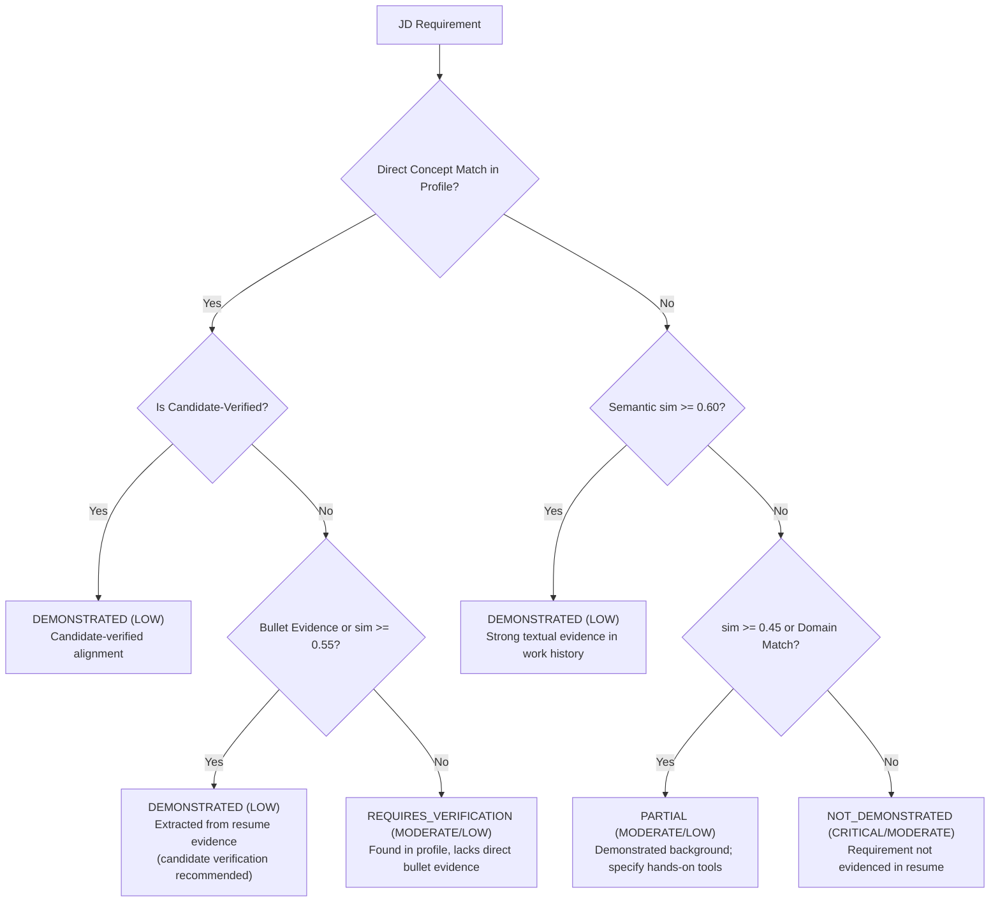

# CareerPilot 2.0 AI & Matching Methodology

## 1. Hybrid 5-Factor Alignment Formulation

Candidate-role match scoring in CareerPilot uses a multi-factor hybrid formulation balancing lexical precision, dense semantic cosine similarity, hierarchical ontology coverage, experience depth, and domain breadth:

$$S_{\text{overall}} = w_{\text{skill}} S_{\text{skill}} + w_{\text{sem}} S_{\text{sem}} + w_{\text{lex}} S_{\text{lex}} + w_{\text{exp}} S_{\text{exp}} + w_{\text{dom}} S_{\text{dom}}$$

### Weight Configuration

| Component | Weight ($w$) | Methodology |
| :--- | :--- | :--- |
| **Skill Ontology Overlap ($S_{\text{skill}}$)** | $0.35$ | Weighted coverage ratio across mandatory ($w_i = 1.0$) and preferred ($w_i = 0.6$) requirements. |
| **Semantic Similarity ($S_{\text{sem}}$)** | $0.25$ | Cosine similarity between requirement embeddings and granular candidate resume bullet vectors. |
| **Lexical BM25 Grounding ($S_{\text{lex}}$)** | $0.15$ | BM25 Okapi term saturation across tokenized resume chunks. |
| **Experience Depth ($S_{\text{exp}}$)** | $0.15$ | Seniority-level threshold scoring evaluating verified tenure against JD requirements. |
| **Domain Breadth ($S_{\text{dom}}$)** | $0.10$ | Cross-functional taxonomy coverage (Cloud, DB, AI, Systems). |

---

## 2. Granular Evidence Retrieval

In CareerPilot 2.0, evidence retrieval operates at the level of discrete atomic items:
- Specific work experience bullet points
- Project accomplishment lines
- Verified degree or certification statements

```
Candidate Resume Document
       │
       ├── Section: Experience
       │     ├── Item: Lead Engineer at Acme
       │     │     ├── Bullet 1: "Built async APIs with Python..."  ──► Chunk 1
       │     │     └── Bullet 2: "Tuned PostgreSQL queries..."      ──► Chunk 2
       │
       └── Section: Skills
             └── "Python, Docker, Kubernetes"                       ──► Line Chunks
```

### Evidence Relevance Cutoff

$$\text{EvidenceSnippet} = \begin{cases} 
\text{direct\_skill.evidence\_text} & \text{if direct verified competency exists} \\
\text{best\_snippet} & \text{if } \text{sim} \ge 0.48 \text{ and } \text{status} \neq \text{NOT\_DEMONSTRATED} \\
\text{None} & \text{otherwise (honest "No evidence found")}
\end{cases}$$

This prevents unrelated multi-paragraph section text from being attached as evidence to technical skill gaps.

---

## 3. 4-Tier Gap Severity Classification

Each JD requirement is evaluated and classified into one of four distinct tiers:



---

## 4. Local Ollama Integration Architecture

CareerPilot integrates with local Ollama daemons (`http://localhost:11434`) with automated failover:

- **Active Local Model:** `qwen2.5-coder:14b` (or `llama3.1:8b`)
- **JSON Mode:** Generates strict JSON schemas enforced via Pydantic response parsing.
- **Failover Mode:** If Ollama is offline or unconfigured, the application falls back to deterministic rule engines (normalizer, BM25, hashed embedding representation) with zero loss of functionality.
