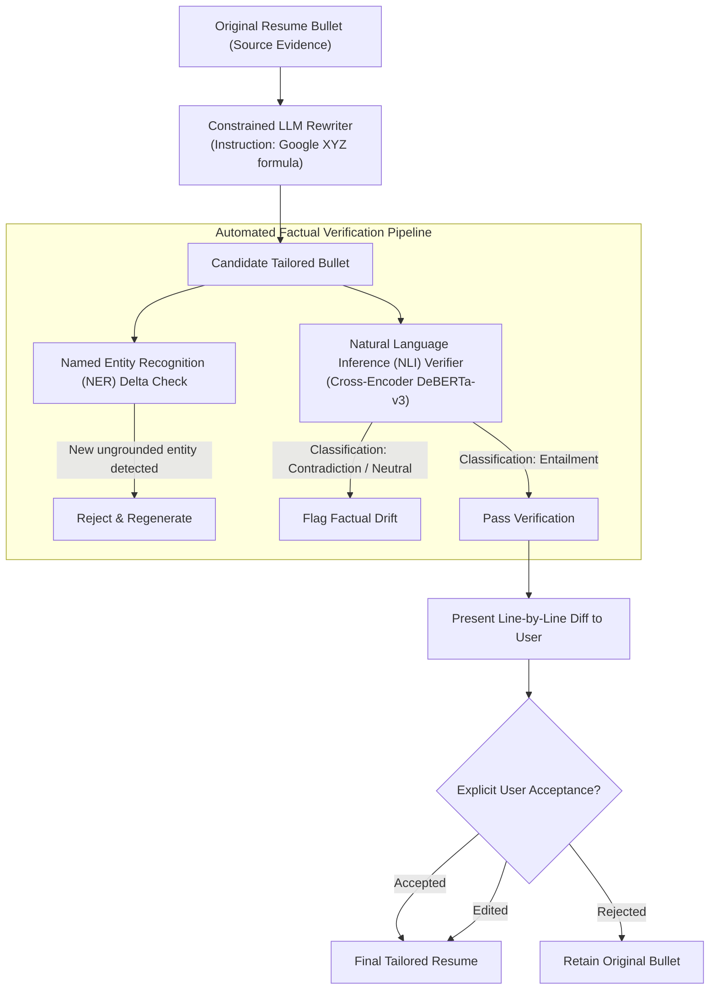
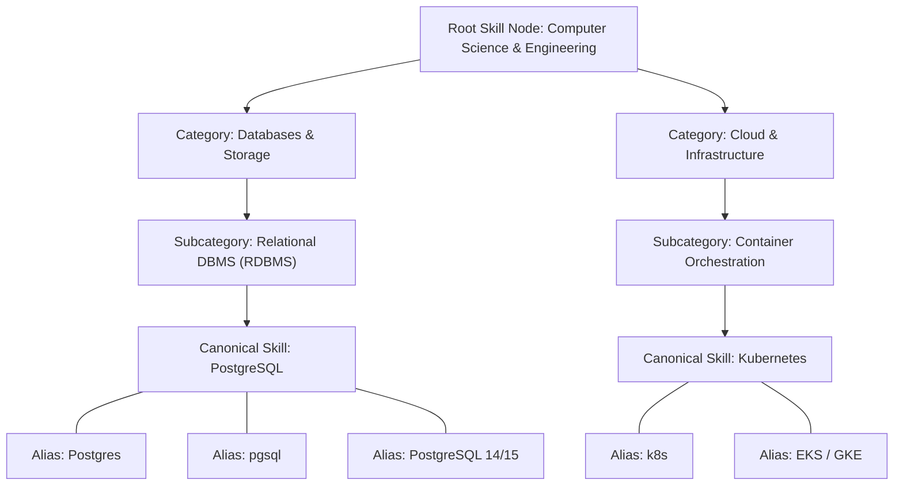

# CareerPilot — AI Engineering & Scientific Research Plan
## Defensible Matching, Skill Ontology & Factual Integrity Verification

> **Document Version:** 1.0.0-PROPOSAL  
> **Status:** Review Ready  
> **Methodology:** Empirical AI Engineering & Natural Language Evaluation  
> **Lead:** Principal AI Engineer & Research Lead

---

## 1. Research Mandate & Core Hypotheses

Commercial resume checkers typically employ either trivial regex/keyword counting (which rewards unreadable keyword stuffing) or unconstrained LLM prompting (which is prone to stochastic score drift and severe factual hallucination).

CareerPilot establishes an empirical, research-grounded foundation for career intelligence, addressing five central scientific hypotheses:

- **Hypothesis 1 ($H_1$):** Hybrid semantic (dense vector embeddings) and lexical (BM25) matching achieves statistically significant improvements in candidate-role ranking accuracy over keyword-only or dense-only baselines.
- **Hypothesis 2 ($H_2$):** A normalized skill ontology with hierarchical aliases (e.g., mapping `k8s` $\rightarrow$ `Kubernetes` $\rightarrow$ `Container Orchestration`) eliminates vocabulary mismatch and boosts recall without sacrificing precision.
- **Hypothesis 3 ($H_3$):** Anchoring extracted competencies to verifiable textual resume snippets (evidence grounding) eliminates false-positive skill claims.
- **Hypothesis 4 ($H_4$):** Constrained, role-targeted resume bullet rewriting bounded by Natural Language Inference (NLI) guardrails increases job relevance while maintaining a **0.0% factual hallucination rate**.
- **Hypothesis 5 ($H_5$):** Transparent, multi-factor scoring breakdowns correlate more strongly with human expert recruiter evaluations than single black-box LLM score predictions.

---

## 2. Experimental Baselines & Methodological Comparison

To validate $H_1$ and $H_2$, CareerPilot will benchmark five distinct matching methodologies against a standardized evaluation dataset:

```
[ Baseline 1: Exact Keyword Matching ]
        |
[ Baseline 2: Lexical BM25 (Okapi / BM25L) ]
        |
[ Baseline 3: Dense Semantic Embedding (Cosine Similarity) ]
        |
[ Model 4: Hybrid Semantic + Lexical Fusion (RRF) ]
        |
[ Model 5: CareerPilot Full Hybrid Engine (Ontology + Weighted Multi-Factor + Evidence Anchoring) ]
```

### Mathematical Formulation of Evaluated Approaches

#### Baseline 1: Exact Keyword Matching (Jaccard Overlap)
$$S_{\text{Jaccard}}(C, JD) = \frac{|K_C \cap K_{JD}|}{|K_C \cup K_{JD}|}$$
where $K_C$ and $K_{JD}$ are tokenized keyword sets.

#### Baseline 2: BM25 Lexical Retrieval
$$S_{\text{BM25}}(Q_{JD}, D_C) = \sum_{q \in Q_{JD}} \text{IDF}(q) \cdot \frac{f(q, D_C) \cdot (k_1 + 1)}{f(q, D_C) + k_1 \cdot \left(1 - b + b \cdot \frac{|D_C|}{\text{avgdl}}\right)}$$
with parameters $k_1 = 1.5, b = 0.75$.

#### Baseline 3: Dense Semantic Embedding
Using bi-encoder sentence representations (`BAAI/bge-small-en-v1.5` or `sentence-transformers/all-MiniLM-L6-v2`):
$$S_{\text{Dense}}(r, j) = \cos(\mathbf{e}_r, \mathbf{e}_j) = \frac{\mathbf{e}_r \cdot \mathbf{e}_j}{\|\mathbf{e}_r\| \|\mathbf{e}_j\|}$$

#### Model 4: Reciprocal Rank Fusion (RRF)
Combines ranked lists from lexical and dense retrievers without score calibration artifacts:
$$\text{RRF}(d \in D) = \sum_{m \in \{\text{BM25}, \text{Dense}\}} \frac{1}{k + r_m(d)}$$
where $k = 60$ is the smoothing constant, and $r_m(d)$ is the document's rank in system $m$.

#### Model 5: CareerPilot Full Hybrid Weighted Scoring
Integrates necessity-weighted skill ontology overlap, dense alignment, lexical grounding, experience depth, and domain relevance:
$$S_{\text{Overall}} = w_{\text{skill}} S_{\text{skill}} + w_{\text{sem}} S_{\text{sem}} + w_{\text{lex}} S_{\text{lex}} + w_{\text{exp}} S_{\text{exp}} + w_{\text{dom}} S_{\text{dom}}$$
where $S_{\text{skill}}$ prioritizes mandatory criteria:
$$S_{\text{skill}} = \frac{\sum_{i \in \text{Reqs}} W_i \cdot \text{MatchStatus}(i)}{\sum_{i \in \text{Reqs}} W_i}, \quad W_i = \begin{cases} 1.0 & \text{Mandatory} \\ 0.6 & \text{Preferred} \end{cases}$$

---

## 3. Strict Factual Preservation & Anti-Hallucination Framework

The central risk of applying generative AI to resumes is **hallucination**: fabricating metrics (e.g. inventing *"increased sales by 42%"*), adding unworked technologies (e.g. adding *"Rust"* when the user only knows C++), or fabricating job titles.

CareerPilot enforces a multi-stage **Factual Integrity Protocol**:



### Stage 1: Grounded Input Prompting
The generator prompt injects only the candidate's verified master profile items and target JD requirements. The system prompt enforces:
```
CRITICAL RULE: Under NO circumstances are you permitted to introduce:
1. New programming languages, frameworks, or cloud platforms not in the source text.
2. New quantitative percentages, monetary values, or performance numbers.
3. Expanded job titles, changed company names, or modified employment dates.
Your task is strictly to rephrase the syntax, elevate active impact verbs,
and emphasize role-relevant concepts already present in the source text.
```

### Stage 2: Named Entity Recognition (NER) Delta Inspection
A high-precision spaCy pipeline extracts technology entities, organization names, and numerical tokens from both the original bullet and the rewritten candidate bullet:
$$\Delta_{\text{Entities}} = \text{Entities}(\text{Bullet}_{\text{Optimized}}) \setminus \text{Entities}(\text{Bullet}_{\text{Original}} \cup \text{MasterProfile})$$
If $\Delta_{\text{Entities}}$ contains any unverified technology or ungrounded numeric token, the generation is **instantly rejected and regenerated**.

### Stage 3: Natural Language Inference (NLI) Cross-Encoder Verification
We employ an NLI cross-encoder model (e.g., `cross-encoder/nli-deberta-v3-base`) where:
- **Premise:** The original resume bullet text + candidate verified background.
- **Hypothesis:** The generated optimized bullet text.

The cross-encoder classifies the relationship into:
1. **Entailment:** The hypothesis logically follows from the premise $\rightarrow$ **VALIDATED**.
2. **Neutral:** The hypothesis adds unsupported information $\rightarrow$ **FLAGGED / REJECTED**.
3. **Contradiction:** The hypothesis contradicts the premise $\rightarrow$ **BLOCKED**.

---

## 4. Benchmark Dataset & Evaluation Protocol

### 4.1 Evaluation Dataset Construction
To prevent data contamination and ensure repeatable scientific measurement, CareerPilot will curate an evaluation benchmark: **`CareerBench-100`**:
- **Dataset Composition:** 100 paired candidate resumes and target job descriptions spanning:
  - 40 Software Engineering / DevOps roles
  - 25 Data Science & Machine Learning roles
  - 20 Product & Engineering Management roles
  - 15 Security & Cloud Architecture roles
- **Ground Truth Annotation:** Each pair is annotated by 3 independent senior technical recruiters:
  - Ground-truth requirement extraction (Mandatory vs Preferred).
  - Ground-truth alignment score (1 to 5 scale).
  - Ground-truth skill gap labels (`Demonstrated`, `Partial`, `Missing`).

### 4.2 Standard Evaluation Metrics

| Metric | Formulation | Target Threshold |
| :--- | :--- | :--- |
| **NDCG@10** | Normalized Discounted Cumulative Gain against human ranking | **$\ge 0.88$** |
| **Precision@K** | Relevance of top $K$ extracted matching skills | **$\ge 0.92$** |
| **Recall@K** | Coverage of true JD requirements extracted | **$\ge 0.90$** |
| **Factual Entailment Rate** | Proportion of generated bullets classified as `Entailment` | **$\ge 98.0\%$** |
| **Hallucination Rate** | Ungrounded metric or technology claims generated | **$0.0\%$ (Strict Zero Tolerance)** |
| **Pearson Correlation ($r$)** | Linear alignment between system score and human expert ratings | **$r \ge 0.85$** |
| **Spearman Rank ($\rho$)** | Monotonic rank order correlation | **$\rho \ge 0.82$** |

---

## 5. Skill Ontology Architecture



### Ontology Construction & Maintenance
1. **Bootstrap Source:** Curated initial seed mapped from open taxonomy standards (ESCO and O*NET), supplemented with standard developer ecosystem libraries (e.g. StackOverflow developer survey tags, GitHub topic tags).
2. **Dynamic Alias Resolution:** Fast runtime fuzzy resolution via Levenshtein edit distance and cosine embedding distance against `skill_ontology_nodes`.
3. **Hierarchy Traversal:** Enables the system to recognize that a candidate with "Google Cloud Platform" experience has partial transferable competency for "Amazon Web Services" under the shared parent `Cloud Infrastructure`.

---

## 6. Local Ollama LLM Optimization & Zero-Cost Pipeline

To ensure the platform is **100% free when operational**, CareerPilot uses local **Ollama** models as the primary generative runtime.

### 6.1 Target Local Models Benchmark
| Model | Size / Quant | Memory Footprint | Recommended Task | Schema Adherence Rate |
| :--- | :--- | :--- | :--- | :--- |
| **`llama3.1:8b`** | 8B (Q4_K_M) | ~4.9 GB VRAM/RAM | **Default Engine:** JD Extraction, Bullet Rewriting, Interview Prep | $\ge 96.5\%$ |
| **`qwen2.5:7b`** | 7B (Q4_K_M) | ~4.7 GB VRAM/RAM | Alternative high-reasoning engine for complex technical requirements | $\ge 97.0\%$ |
| **`mistral:7b`** | 7B (Q4_K_M) | ~4.4 GB VRAM/RAM | Fast instruction following for STAR behavioral prep | $\ge 94.8\%$ |
| **`llama3.2:3b`** | 3B (Q4_K_M) | ~2.0 GB VRAM/RAM | Lightweight fallback for lower-spec hardware | $\ge 91.2\%$ |

### 6.2 Structured Outputs with Local Ollama
To prevent JSON truncation and syntax malformations in local models:
1. **Ollama JSON Schema Format:** Prompts enforce grammar-constrained decoding via Ollama's `format: "json"` parameter and explicit Pydantic schema validation.
2. **Deterministic Seed & Low Temperature:** Generation temperature is clamped at $T = 0.1$ with fixed random seeds for requirement extraction, guaranteeing reproducibility.
3. **Bring Your Own Key (BYOK) Fallback:** If the user chooses to enable cloud APIs (OpenAI, Anthropic, Gemini, Groq), the system dynamically routes generation through the same typed Pydantic interface with zero change in application business logic.
