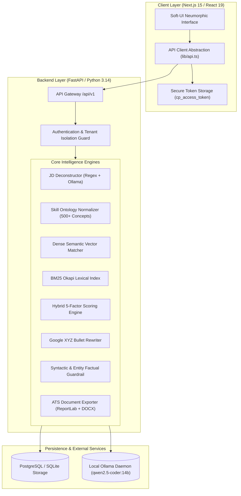
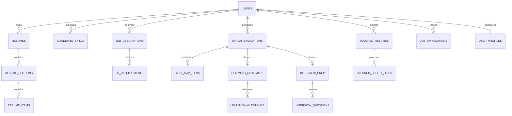

# CareerPilot 2.0 System Architecture & Technical Specification

## 1. System Overview & Core Promise

CareerPilot is an AI-powered, local-first career intelligence platform designed to eliminate the guesswork from technical job seeking. Its architecture transforms raw candidate experience documents into verifiable, evidence-anchored competencies, accurately assesses alignment against target job descriptions, and generates ATS-optimized resumes adhering strictly to factual preservation guardrails.

```
       ┌────────────────────────┐
       │   MY CAREER PROFILE    │
       │ (Documents & Evidence) │
       └───────────┬────────────┘
                   │
                   ▼
       ┌────────────────────────┐
       │      JOB ANALYSIS      │
       │ (Structured JD Engine) │
       └───────────┬────────────┘
                   │
                   ▼
       ┌────────────────────────┐
       │      GAP ANALYSIS      │
       │  (Hybrid 5-Factor Sim) │
       └───────────┬────────────┘
                   │
                   ▼
       ┌────────────────────────┐
       │     RESUME STUDIO      │
       │  (Google XYZ Formula)  │
       └───────────┬────────────┘
                   │
                   ▼
       ┌────────────────────────┐
       │   FACTUAL VALIDATION   │
       │  (Anti-Hallucination)  │
       └───────────┬────────────┘
                   │
                   ▼
       ┌────────────────────────┐
       │   ATS EXPORT ENGINE    │
       │     (PDF & DOCX)       │
       └────────────────────────┘
```

---

## 2. High-Level Architecture & Component Topology



---

## 3. Module Boundaries & Responsibilities

### Module 1: Authentication & Workspace Security
- **Endpoints:** `/api/v1/auth/register`, `/api/v1/auth/login`, `/api/v1/auth/refresh`, `/api/v1/users/me`
- **Security:** Argon2id / bcrypt password hashing, cryptographic JWT bearer tokens, sliding refresh window, GDPR account purge with cascading deletion.
- **Tenant Isolation:** Enforced on every database query via `user_id == current_user.id`.

### Module 2: Ingestion & Document Segmentation
- **Endpoints:** `/api/v1/resumes/upload`, `/api/v1/resumes`, `/api/v1/resumes/{id}`
- **Processing:** Multi-format parser (PDF via pdfplumber, DOCX via python-docx), heading hierarchy segmenter, granular item bullet extraction.

### Module 3: JD Intelligence Engine
- **Endpoints:** `/api/v1/jobs/analyze`, `/api/v1/jobs`, `/api/v1/jobs/{id}`
- **Intelligence:** Sentence-level requirement decomposition for both bulleted and narrative paragraph job descriptions, experience threshold extraction, mandatory vs. preferred classification.

### Module 4: Candidate Intelligence & Master Profile
- **Endpoints:** `/api/v1/candidate/profile`, `/api/v1/candidate/build-profile`, `/api/v1/candidate/skills/{id}/verify`
- **Integrity:** Anchors every competency to verbatim resume bullet evidence. Strictly isolates automatically extracted skills from candidate-verified competencies.

### Module 5 & 6: Hybrid Matching & Skill Gap Analysis
- **Endpoints:** `/api/v1/matches/evaluate`, `/api/v1/matches`, `/api/v1/matches/{id}`, `/api/v1/matches/{id}/gaps/verify`
- **Engine:** Combines BM25 lexical ranking (15%), dense semantic cosine similarity (25%), skill ontology overlap (35%), experience depth (15%), and domain relevance (10%).

### Module 7: Resume Studio & ATS Generation
- **Endpoints:** `/api/v1/optimizer/tailor`, `/api/v1/optimizer/tailored-resumes/{id}`, `/api/v1/optimizer/diffs/{id}`, `/api/v1/optimizer/tailored-resumes/{id}/export-pdf`
- **Tailoring:** Maps bullets to target requirements via semantic relevance, enforces Google XYZ syntax (`Accomplished [X] as measured by [Y] by doing [Z]`), verifies zero hallucinated metrics or technologies, exports ATS-compliant single-column PDF and DOCX.

### Module 8 & 9: Career Development Intelligence
- **Endpoints:** `/api/v1/learning/generate`, `/api/v1/learning/milestones/{id}`, `/api/v1/interview/generate`, `/api/v1/interview/questions/{id}/evaluate`
- **Curriculum:** Curated technical learning blueprints for 15+ engineering domains and practical portfolio projects.
- **Interviews:** STAR framing guidelines (Situation, Task, Action, Result) providing authentic candidate answering frameworks without fabricating fake past stories.

### Module 10: Application Pipeline
- **Endpoints:** `/api/v1/applications`, `/api/v1/applications/{id}/stage`, `/api/v1/applications/compare`
- **Tracking:** Kanban and table views tracking opportunities across 6 hiring stages, directly linked to target JDs, gap evaluations, and tailored resume snapshots.

---

## 4. Database Entity-Relationship Model


