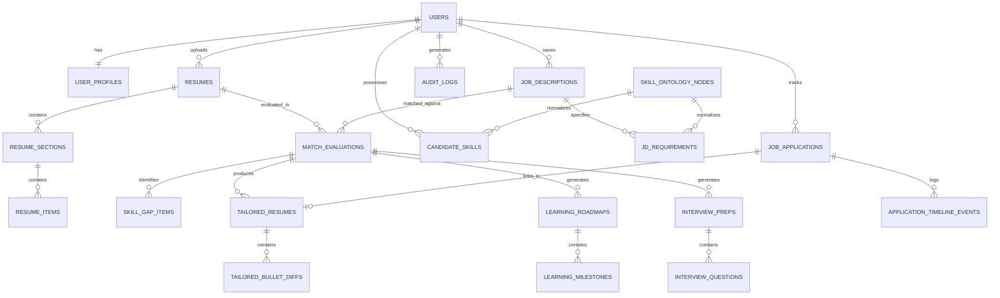

# CareerPilot — Database Design & Data Architecture
## Relational & Vector Schema Specification (PostgreSQL 16 + pgvector)

> **Document Version:** 1.0.0-PROPOSAL  
> **Status:** Review Ready  
> **Target RDBMS:** PostgreSQL 16+ with `pgvector` extension  
> **ORM & Migrations:** SQLAlchemy 2.0 (Async) + Alembic

---

## 1. Data Modeling Philosophy & Tenant Isolation

CareerPilot stores relational entities, hierarchical document structures, and dense vector embeddings within a unified, ACID-compliant PostgreSQL database.

### Core Principles
1. **Strict User-Level Tenancy (`user_id` Foreign Key Scoping):**
   Every customer-owned entity (`resumes`, `job_descriptions`, `match_evaluations`, `tailored_resumes`, `job_applications`, etc.) maintains an indexed `user_id` foreign key referencing `users(id) ON DELETE CASCADE`. Database queries must strictly include `WHERE user_id = :current_user_id`.
2. **ACID Integrity with pgvector Co-Location:**
   Vector embeddings are stored as native `vector(384)` columns within section and requirement tables, eliminating dual-write synchronization hazards common with external vector databases.
3. **Auditability & Traceability:**
   All generative modifications (bullet rewrites, gap analyses) maintain back-references to source resume sections and JD requirements. An append-only `audit_logs` table tracks security-sensitive actions.

---

## 2. Entity-Relationship (ER) Diagram



---

## 3. Detailed Table Definitions & Schemas

### 3.1 Authentication & Workspace (`users`, `user_profiles`)

```sql
CREATE TABLE users (
    id UUID PRIMARY KEY DEFAULT gen_random_uuid(),
    email VARCHAR(255) UNIQUE NOT NULL,
    hashed_password VARCHAR(255) NOT NULL,
    full_name VARCHAR(255) NOT NULL,
    is_active BOOLEAN NOT NULL DEFAULT TRUE,
    is_verified BOOLEAN NOT NULL DEFAULT FALSE,
    created_at TIMESTAMPTZ NOT NULL DEFAULT CURRENT_TIMESTAMP,
    updated_at TIMESTAMPTZ NOT NULL DEFAULT CURRENT_TIMESTAMP
);

CREATE TABLE user_profiles (
    id UUID PRIMARY KEY DEFAULT gen_random_uuid(),
    user_id UUID UNIQUE NOT NULL REFERENCES users(id) ON DELETE CASCADE,
    headline VARCHAR(255),
    target_role_title VARCHAR(255),
    target_seniority VARCHAR(50),
    years_of_experience NUMERIC(4, 1),
    linkedin_url VARCHAR(512),
    github_url VARCHAR(512),
    portfolio_url VARCHAR(512),
    preferences JSONB DEFAULT '{}'::jsonb,
    created_at TIMESTAMPTZ NOT NULL DEFAULT CURRENT_TIMESTAMP,
    updated_at TIMESTAMPTZ NOT NULL DEFAULT CURRENT_TIMESTAMP
);
```

---

### 3.2 Ingestion & Candidate Master Profile (`resumes`, `resume_sections`, `resume_items`, `candidate_skills`)

```sql
CREATE TABLE resumes (
    id UUID PRIMARY KEY DEFAULT gen_random_uuid(),
    user_id UUID NOT NULL REFERENCES users(id) ON DELETE CASCADE,
    file_name VARCHAR(255) NOT NULL,
    file_key VARCHAR(512) NOT NULL,              -- S3 / MinIO storage key
    file_format VARCHAR(10) NOT NULL,            -- 'pdf', 'docx'
    file_size_bytes INTEGER NOT NULL,
    raw_text TEXT NOT NULL,
    is_master BOOLEAN NOT NULL DEFAULT FALSE,    -- Designates master profile source
    parsing_status VARCHAR(50) NOT NULL DEFAULT 'PENDING', -- 'PENDING', 'PARSED', 'FAILED'
    ocr_applied BOOLEAN NOT NULL DEFAULT FALSE,
    created_at TIMESTAMPTZ NOT NULL DEFAULT CURRENT_TIMESTAMP,
    updated_at TIMESTAMPTZ NOT NULL DEFAULT CURRENT_TIMESTAMP
);

CREATE TABLE resume_sections (
    id UUID PRIMARY KEY DEFAULT gen_random_uuid(),
    resume_id UUID NOT NULL REFERENCES resumes(id) ON DELETE CASCADE,
    section_type VARCHAR(50) NOT NULL,           -- 'experience', 'education', 'skills', 'projects'
    heading VARCHAR(255) NOT NULL,
    raw_content TEXT NOT NULL,
    display_order INTEGER NOT NULL DEFAULT 0,
    embedding vector(384),                       -- 384-dim BGE/MiniLM dense vector
    created_at TIMESTAMPTZ NOT NULL DEFAULT CURRENT_TIMESTAMP
);

CREATE TABLE resume_items (
    id UUID PRIMARY KEY DEFAULT gen_random_uuid(),
    section_id UUID NOT NULL REFERENCES resume_sections(id) ON DELETE CASCADE,
    item_type VARCHAR(50) NOT NULL,              -- 'job_position', 'degree', 'project_entry'
    title VARCHAR(255) NOT NULL,                 -- e.g. "Senior Software Engineer"
    organization VARCHAR(255),                   -- e.g. "Acme Corp"
    location VARCHAR(255),
    start_date DATE,
    end_date DATE,
    is_current BOOLEAN DEFAULT FALSE,
    bullets JSONB NOT NULL DEFAULT '[]'::jsonb,  -- Array of { id, text, raw_evidence }
    embedding vector(384),
    created_at TIMESTAMPTZ NOT NULL DEFAULT CURRENT_TIMESTAMP
);

CREATE TABLE candidate_skills (
    id UUID PRIMARY KEY DEFAULT gen_random_uuid(),
    user_id UUID NOT NULL REFERENCES users(id) ON DELETE CASCADE,
    skill_name VARCHAR(255) NOT NULL,
    normalized_name VARCHAR(255) NOT NULL,       -- Matches ontology canonical name
    category VARCHAR(100) NOT NULL,              -- 'languages', 'databases', 'cloud'
    proficiency_level VARCHAR(50),               -- 'familiar', 'proficient', 'expert'
    years_experience NUMERIC(4, 1),
    evidence_item_ids JSONB DEFAULT '[]'::jsonb, -- References to resume_items(id)
    is_user_verified BOOLEAN NOT NULL DEFAULT FALSE,
    created_at TIMESTAMPTZ NOT NULL DEFAULT CURRENT_TIMESTAMP
);
```

---

### 3.3 Skill Ontology (`skill_ontology_nodes`)

```sql
CREATE TABLE skill_ontology_nodes (
    id UUID PRIMARY KEY DEFAULT gen_random_uuid(),
    canonical_name VARCHAR(255) UNIQUE NOT NULL, -- e.g. "PostgreSQL"
    aliases JSONB NOT NULL DEFAULT '[]'::jsonb,  -- e.g. ["postgres", "pgsql", "postgresql"]
    category VARCHAR(100) NOT NULL,              -- 'Databases & Storage'
    parent_id UUID REFERENCES skill_ontology_nodes(id),
    related_skill_ids JSONB DEFAULT '[]'::jsonb, -- e.g. related to SQL, Relational DBs
    embedding vector(384),
    created_at TIMESTAMPTZ NOT NULL DEFAULT CURRENT_TIMESTAMP
);
```

---

### 3.4 JD Intelligence (`job_descriptions`, `jd_requirements`)

```sql
CREATE TABLE job_descriptions (
    id UUID PRIMARY KEY DEFAULT gen_random_uuid(),
    user_id UUID NOT NULL REFERENCES users(id) ON DELETE CASCADE,
    job_title VARCHAR(255) NOT NULL,
    company_name VARCHAR(255),
    raw_text TEXT NOT NULL,
    department VARCHAR(255),
    seniority_level VARCHAR(50),                 -- 'Junior', 'Mid', 'Senior', 'Staff'
    work_mode VARCHAR(50),                       -- 'Remote', 'Hybrid', 'Onsite'
    location VARCHAR(255),
    salary_range VARCHAR(100),
    created_at TIMESTAMPTZ NOT NULL DEFAULT CURRENT_TIMESTAMP
);

CREATE TABLE jd_requirements (
    id UUID PRIMARY KEY DEFAULT gen_random_uuid(),
    jd_id UUID NOT NULL REFERENCES job_descriptions(id) ON DELETE CASCADE,
    requirement_text TEXT NOT NULL,
    category VARCHAR(50) NOT NULL,               -- 'technical_skill', 'soft_skill', 'education', 'experience'
    is_mandatory BOOLEAN NOT NULL DEFAULT TRUE,  -- TRUE = required, FALSE = preferred
    importance_weight NUMERIC(3, 2) NOT NULL DEFAULT 1.0, -- 1.0 (Must) to 0.4 (Bonus)
    min_years_experience NUMERIC(4, 1),
    canonical_skill_id UUID REFERENCES skill_ontology_nodes(id),
    embedding vector(384),
    created_at TIMESTAMPTZ NOT NULL DEFAULT CURRENT_TIMESTAMP
);
```

---

### 3.5 Matching & Gap Analysis (`match_evaluations`, `skill_gap_items`)

```sql
CREATE TABLE match_evaluations (
    id UUID PRIMARY KEY DEFAULT gen_random_uuid(),
    user_id UUID NOT NULL REFERENCES users(id) ON DELETE CASCADE,
    resume_id UUID NOT NULL REFERENCES resumes(id) ON DELETE CASCADE,
    jd_id UUID NOT NULL REFERENCES job_descriptions(id) ON DELETE CASCADE,
    overall_score NUMERIC(5, 2) NOT NULL,        -- 0.00 to 100.00
    lexical_score NUMERIC(5, 2) NOT NULL,
    semantic_score NUMERIC(5, 2) NOT NULL,
    skill_match_score NUMERIC(5, 2) NOT NULL,
    experience_score NUMERIC(5, 2) NOT NULL,
    domain_score NUMERIC(5, 2) NOT NULL,
    scoring_breakdown JSONB NOT NULL DEFAULT '{}'::jsonb,
    summary_analysis TEXT,
    created_at TIMESTAMPTZ NOT NULL DEFAULT CURRENT_TIMESTAMP
);

CREATE TABLE skill_gap_items (
    id UUID PRIMARY KEY DEFAULT gen_random_uuid(),
    match_evaluation_id UUID NOT NULL REFERENCES match_evaluations(id) ON DELETE CASCADE,
    requirement_id UUID NOT NULL REFERENCES jd_requirements(id) ON DELETE CASCADE,
    status VARCHAR(50) NOT NULL,                 -- 'DEMONSTRATED', 'PARTIAL', 'NOT_DEMONSTRATED', 'REQUIRES_VERIFICATION'
    gap_severity VARCHAR(20) NOT NULL,           -- 'CRITICAL', 'MODERATE', 'LOW'
    evidence_snippet TEXT,                       -- Extracted candidate resume excerpt
    similarity_score NUMERIC(4, 3),              -- Cosine similarity
    suggested_action TEXT,
    is_resolved BOOLEAN NOT NULL DEFAULT FALSE,
    created_at TIMESTAMPTZ NOT NULL DEFAULT CURRENT_TIMESTAMP
);
```

---

### 3.6 Resume Optimizer (`tailored_resumes`, `tailored_bullet_diffs`)

```sql
CREATE TABLE tailored_resumes (
    id UUID PRIMARY KEY DEFAULT gen_random_uuid(),
    user_id UUID NOT NULL REFERENCES users(id) ON DELETE CASCADE,
    source_resume_id UUID NOT NULL REFERENCES resumes(id) ON DELETE CASCADE,
    target_jd_id UUID NOT NULL REFERENCES job_descriptions(id) ON DELETE CASCADE,
    match_evaluation_id UUID REFERENCES match_evaluations(id),
    version_title VARCHAR(255) NOT NULL,
    tailored_content JSONB NOT NULL,             -- Complete structured resume snapshot
    pdf_export_key VARCHAR(512),                 -- S3 path to generated PDF
    docx_export_key VARCHAR(512),                -- S3 path to generated DOCX
    created_at TIMESTAMPTZ NOT NULL DEFAULT CURRENT_TIMESTAMP,
    updated_at TIMESTAMPTZ NOT NULL DEFAULT CURRENT_TIMESTAMP
);

CREATE TABLE tailored_bullet_diffs (
    id UUID PRIMARY KEY DEFAULT gen_random_uuid(),
    tailored_resume_id UUID NOT NULL REFERENCES tailored_resumes(id) ON DELETE CASCADE,
    original_text TEXT NOT NULL,
    optimized_text TEXT NOT NULL,
    rationale TEXT NOT NULL,
    targeted_requirement_id UUID REFERENCES jd_requirements(id),
    nli_verification_status VARCHAR(50) NOT NULL, -- 'ENTAILMENT' (passed), 'NEUTRAL', 'FLAGGED'
    status VARCHAR(20) NOT NULL DEFAULT 'PENDING',-- 'PENDING', 'ACCEPTED', 'REJECTED', 'EDITED'
    edited_text TEXT,
    created_at TIMESTAMPTZ NOT NULL DEFAULT CURRENT_TIMESTAMP
);
```

---

### 3.7 Career Progression & Interview (`learning_roadmaps`, `learning_milestones`, `interview_preps`, `interview_questions`)

```sql
CREATE TABLE learning_roadmaps (
    id UUID PRIMARY KEY DEFAULT gen_random_uuid(),
    user_id UUID NOT NULL REFERENCES users(id) ON DELETE CASCADE,
    match_evaluation_id UUID NOT NULL REFERENCES match_evaluations(id) ON DELETE CASCADE,
    target_role_title VARCHAR(255) NOT NULL,
    estimated_total_hours INTEGER,
    status VARCHAR(50) NOT NULL DEFAULT 'ACTIVE',
    created_at TIMESTAMPTZ NOT NULL DEFAULT CURRENT_TIMESTAMP
);

CREATE TABLE learning_milestones (
    id UUID PRIMARY KEY DEFAULT gen_random_uuid(),
    roadmap_id UUID NOT NULL REFERENCES learning_roadmaps(id) ON DELETE CASCADE,
    sequence_order INTEGER NOT NULL DEFAULT 1,
    skill_name VARCHAR(255) NOT NULL,
    milestone_title VARCHAR(255) NOT NULL,
    description TEXT NOT NULL,
    curated_resources JSONB DEFAULT '[]'::jsonb,
    practical_project_brief TEXT,
    is_completed BOOLEAN NOT NULL DEFAULT FALSE,
    created_at TIMESTAMPTZ NOT NULL DEFAULT CURRENT_TIMESTAMP
);

CREATE TABLE interview_preps (
    id UUID PRIMARY KEY DEFAULT gen_random_uuid(),
    user_id UUID NOT NULL REFERENCES users(id) ON DELETE CASCADE,
    match_evaluation_id UUID NOT NULL REFERENCES match_evaluations(id) ON DELETE CASCADE,
    created_at TIMESTAMPTZ NOT NULL DEFAULT CURRENT_TIMESTAMP
);

CREATE TABLE interview_questions (
    id UUID PRIMARY KEY DEFAULT gen_random_uuid(),
    prep_id UUID NOT NULL REFERENCES interview_preps(id) ON DELETE CASCADE,
    question_type VARCHAR(50) NOT NULL,          -- 'TECHNICAL', 'BEHAVIORAL_STAR', 'GAP_DEFENSE'
    question_text TEXT NOT NULL,
    target_skill_or_gap VARCHAR(255),
    evaluation_criteria TEXT NOT NULL,
    star_guidelines JSONB DEFAULT '{}'::jsonb,
    practice_response TEXT,
    ai_feedback TEXT,
    created_at TIMESTAMPTZ NOT NULL DEFAULT CURRENT_TIMESTAMP
);
```

---

### 3.8 Application Tracking & Audit (`job_applications`, `application_timeline_events`, `audit_logs`)

```sql
CREATE TABLE job_applications (
    id UUID PRIMARY KEY DEFAULT gen_random_uuid(),
    user_id UUID NOT NULL REFERENCES users(id) ON DELETE CASCADE,
    jd_id UUID REFERENCES job_descriptions(id) ON DELETE SET NULL,
    tailored_resume_id UUID REFERENCES tailored_resumes(id) ON DELETE SET NULL,
    company_name VARCHAR(255) NOT NULL,
    position_title VARCHAR(255) NOT NULL,
    status VARCHAR(50) NOT NULL DEFAULT 'BOOKMARKED', -- 'BOOKMARKED', 'TAILORING', 'APPLIED', 'INTERVIEWING', 'OFFER', 'REJECTED'
    applied_date DATE,
    compensation_notes VARCHAR(255),
    notes TEXT,
    created_at TIMESTAMPTZ NOT NULL DEFAULT CURRENT_TIMESTAMP,
    updated_at TIMESTAMPTZ NOT NULL DEFAULT CURRENT_TIMESTAMP
);

CREATE TABLE application_timeline_events (
    id UUID PRIMARY KEY DEFAULT gen_random_uuid(),
    application_id UUID NOT NULL REFERENCES job_applications(id) ON DELETE CASCADE,
    event_type VARCHAR(50) NOT NULL,             -- 'STATUS_CHANGE', 'NOTE_ADDED', 'INTERVIEW_SCHEDULED'
    description TEXT NOT NULL,
    event_timestamp TIMESTAMPTZ NOT NULL DEFAULT CURRENT_TIMESTAMP
);

CREATE TABLE audit_logs (
    id UUID PRIMARY KEY DEFAULT gen_random_uuid(),
    user_id UUID REFERENCES users(id) ON DELETE SET NULL,
    action VARCHAR(100) NOT NULL,                -- 'RESUME_UPLOAD', 'DATA_PURGE', 'RESUME_EXPORT'
    ip_address VARCHAR(45),
    user_agent TEXT,
    metadata JSONB DEFAULT '{}'::jsonb,
    created_at TIMESTAMPTZ NOT NULL DEFAULT CURRENT_TIMESTAMP
);
```

---

## 4. Indexing Strategy & Vector Indexing (HNSW)

```sql
-- User Tenancy & Lookup Indexes
CREATE INDEX idx_resumes_user_id ON resumes(user_id);
CREATE INDEX idx_job_descriptions_user_id ON job_descriptions(user_id);
CREATE INDEX idx_match_evaluations_user_id ON match_evaluations(user_id);
CREATE INDEX idx_job_applications_user_id_status ON job_applications(user_id, status);
CREATE INDEX idx_candidate_skills_user_normalized ON candidate_skills(user_id, normalized_name);

-- Vector Similarity Indexes (HNSW using Cosine Distance)
CREATE INDEX idx_resume_sections_embedding ON resume_sections 
USING hnsw (embedding vector_cosine_ops) 
WITH (m = 16, ef_construction = 64);

CREATE INDEX idx_jd_requirements_embedding ON jd_requirements 
USING hnsw (embedding vector_cosine_ops) 
WITH (m = 16, ef_construction = 64);

CREATE INDEX idx_skill_ontology_embedding ON skill_ontology_nodes 
USING hnsw (embedding vector_cosine_ops) 
WITH (m = 16, ef_construction = 64);
```

---

## 5. Data Retention, Soft Deletion & GDPR Purge Policy

1. **User Data Isolation & Ownership:** Users have exclusive sovereignty over their data. No candidate resume or profile is visible to other users.
2. **One-Click Account Purge:** Invoking `DELETE /api/v1/users/me` triggers a cascading database deletion across all tables (`resumes`, `job_descriptions`, `matches`, `audit_logs`). A Celery job deletes all associated binary files from S3/MinIO.
3. **Retention of Ephemeral Matching Logs:** Transient Celery task state in Redis expires automatically via Redis TTL (24 hours).
