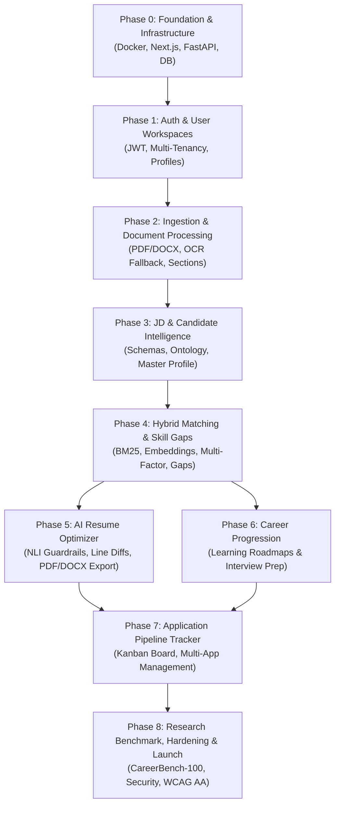

# CareerPilot — Comprehensive Implementation Roadmap
## Phased Execution Strategy & Milestone Specifications

> **Document Version:** 1.0.0-PROPOSAL  
> **Status:** Review Ready  
> **Execution Model:** Phased, Independently Verifiable Increments  
> **Author:** Principal Software Architect & Technical Lead

---

## 1. Execution Philosophy & Phasing Overview

CareerPilot is organized into **nine sequential development phases (Phases 0 through 8)**. Each phase produces a self-contained, testable, and demonstrable increment. Implementation tasks are strictly ordered so that foundational infrastructure precedes domain logic, domain logic precedes AI synthesis, and individual features are tested against objective acceptance criteria before proceeding.



---

## 2. Phase-by-Phase Execution Plan

---

### PHASE 0: Project Setup, Tooling & Infrastructure Foundation
- **Primary Objectives:** Establish development environment, repository scaffolding, monorepo/polyrepo structure, containerization, database migrations, and CI linting pipelines.
- **Features & Deliverables:**
  - Standardized root project workspace with `/frontend` (Next.js 15) and `/backend` (FastAPI).
  - Docker Compose orchestration (`frontend`, `backend`, `celery`, `postgres` with `pgvector`, `redis`, `minio`).
  - Local **Ollama** service integration & connectivity checks (`OLLAMA_BASE_URL=http://host.docker.internal:11434`), verifying zero-cost local LLM execution.
  - Base Tailwind CSS v4 setup with custom Soft UI Evolution tokens and design primitives.
  - SQLAlchemy async database engine, Alembic configuration, and initial migration scripts.
  - GitHub Actions CI workflow (linting, type checks with `mypy` and `tsc`, unit test execution).
- **Key Modules / Files:**
  - `docker-compose.yml`, `Makefile`, `.env.example`
  - `backend/app/main.py`, `backend/app/core/config.py`, `backend/app/core/database.py`, `backend/app/core/llm.py`
  - `frontend/package.json`, `frontend/src/app/layout.tsx`, `frontend/src/styles/globals.css`
- **Definition of Done (DoD):** `docker compose up` brings up all services cleanly without errors; backend passes health check at `GET /health` and confirms Ollama connection; frontend renders Soft UI canvas at `localhost:3000`.

---

### PHASE 1: Authentication & User Workspaces (Module 1)
- **Primary Objectives:** Implement secure multi-user tenant authentication, password hashing, JWT lifecycle, and user profile management.
- **Features & Deliverables:**
  - User registration, login, token refresh, and logout endpoints.
  - Argon2id password hashing and JWT issuance.
  - Dependency-injected user context ensuring 100% tenant query scoping.
  - Soft UI authentication interfaces (Login, Register, Forgot Password).
  - User Profile settings and preferences view.
- **Key Modules / Files:**
  - `backend/app/modules/auth/` (router, service, models, schemas, security)
  - `backend/app/modules/users/` (router, models, schemas)
  - `frontend/src/app/(auth)/login/page.tsx`, `frontend/src/app/(auth)/register/page.tsx`
  - `frontend/src/components/ui/button.tsx`, `frontend/src/components/ui/input.tsx`
- **Definition of Done (DoD):** Automated tests prove cross-tenant data leakage is impossible; registration, login, and profile editing succeed end-to-end.

---

### PHASE 2: Document Ingestion & Parsing Engine (Module 2)
- **Primary Objectives:** Build high-reliability document ingestion supporting PDF, DOCX, and scanned documents via OCR fallback.
- **Features & Deliverables:**
  - S3 / MinIO file upload and storage engine.
  - Dual PDF parsing: `pdfplumber` for digital PDFs, auto-fallback to `pytesseract` for scanned resumes.
  - `python-docx` parser with bullet point and heading extraction.
  - Heuristic and regex section segmenter (Contact, Experience, Education, Skills, Projects).
  - Celery background worker integration for asynchronous document processing.
  - Frontend Resume Upload Workspace with drag-and-drop zone, PDF viewer, and parsed section review editor.
- **Key Modules / Files:**
  - `backend/app/modules/ingestion/` (extractors, ocr, segmenter, tasks)
  - `frontend/src/app/dashboard/resumes/upload/page.tsx`
  - `frontend/src/components/ingestion/pdf-viewer.tsx`, `section-editor.tsx`
- **Definition of Done (DoD):** Successfully parses 10 sample digital resumes and 2 scanned image resumes with $>98\%$ text fidelity; user can review and edit parsed sections in the UI.

---

### PHASE 3: JD & Candidate Intelligence Engines (Modules 3 & 4)
- **Primary Objectives:** Convert parsed resumes into an authoritative, reusable Master Candidate Profile with evidence anchors, and decompose JDs into structured requirement taxonomies.
- **Features & Deliverables:**
  - Structured JD decomposition via Pydantic v2 schemas and local Ollama model extraction (e.g., `llama3.1:8b` / `qwen2.5:7b`), with optional BYOK cloud fallback.
  - Mandatory vs Preferred requirement classification and experience year extraction.
  - Canonical Skill Ontology with hierarchical aliases and cosine embedding representation.
  - Candidate Master Profile builder: extracts structured competencies, work history, and binds every skill to its source resume bullet ID (evidence anchoring).
  - Frontend Job Analyzer workspace, Master Profile Hub, and Model Configuration panel.
- **Key Modules / Files:**
  - `backend/app/modules/jd_engine/` (router, extractor, schemas)
  - `backend/app/modules/candidate/` (master profile builder, evidence graph)
  - `backend/app/modules/ontology/` (seed data, normalizer)
  - `frontend/src/app/dashboard/jobs/analyze/page.tsx`, `master-profile/page.tsx`
- **Definition of Done (DoD):** Master profile persists across sessions; extracted JD requirements conform 100% to Pydantic schema validation; skills link to exact resume evidence bullets.

---

### PHASE 4: Candidate-Role Hybrid Matching & Skill Gap Engine (Modules 5 & 6)
- **Primary Objectives:** Build the scientific hybrid matching engine (BM25 + Sentence Transformers + Ontology) and transparent skill gap categorization.
- **Features & Deliverables:**
  - In-memory/Postgres BM25 lexical indexer for resume-JD alignment.
  - SentenceTransformer dense embeddings calculation (`BAAI/bge-small-en-v1.5`) stored in pgvector.
  - Reciprocal Rank Fusion (RRF) and 5-factor weighted scoring model ($S_{skill}, S_{sem}, S_{lex}, S_{exp}, S_{dom}$).
  - Four-tier gap classification: `Demonstrated`, `Partially Demonstrated`, `Not Demonstrated`, `Requires Verification`.
  - Frontend Match Report page with tactile radial score dial, multi-factor meter bars, and slide-over evidence drawer.
  - Interactive Skill Gap quick-verification modal.
- **Key Modules / Files:**
  - `backend/app/modules/matching/` (bm25, dense, rrf, scorer)
  - `backend/app/modules/skill_gap/` (categorizer, verifier)
  - `frontend/src/app/dashboard/matches/[id]/page.tsx`, `gaps/page.tsx`
  - `frontend/src/components/matching/radial-gauge.tsx`, `evidence-drawer.tsx`
- **Definition of Done (DoD):** Hybrid match score executes in $\le 1.5$ seconds; every requirement displays transparent evidence or gap rationale; verification modal recalculates score dynamically.

---

### PHASE 5: AI Resume Optimizer & Live Editor (Module 7)
- **Primary Objectives:** Role-specific bullet point optimizer with strict anti-hallucination guardrails (NLI verification), interactive diff approval, and ATS export.
- **Features & Deliverables:**
  - Role-targeted bullet rewriter enforcing the Google XYZ accomplishment formula.
  - Multi-stage factual integrity guardrail: NER entity delta checking and DeBERTa-v3 NLI entailment verification.
  - Interactive split-screen Resume Editor: side-by-side diff review cards with individual `[Accept]`, `[Reject]`, and `[Edit]` buttons.
  - Live ATS document preview canvas updating in real-time.
  - ATS-compliant single-column PDF export (`ReportLab` / `WeasyPrint`) and clean DOCX export.
- **Key Modules / Files:**
  - `backend/app/modules/optimizer/` (rewriter, nli_guardrail, exporter)
  - `frontend/src/app/dashboard/optimizer/[id]/page.tsx`
  - `frontend/src/components/optimizer/diff-viewer.tsx`, `live-preview.tsx`
- **Definition of Done (DoD):** Automated tests verify 0% introduced hallucinated metrics; exported PDF passes standard ATS parsing; diff acceptance workflow functions end-to-end.

---

### PHASE 6: Personalized Learning & Interview Intelligence (Modules 8 & 9)
- **Primary Objectives:** Equip candidates with prioritized skill acquisition roadmaps and tailored interview preparation.
- **Features & Deliverables:**
  - Personalized Learning Roadmap generator: converts unresolved skill gaps into chronological milestones, curated resource links, and concrete portfolio project briefs.
  - Interview Intelligence generator: role-specific technical deep-dives, behavioral questions with STAR answering guidelines, and gap-defense prompts.
  - Interactive interview practice terminal with AI evaluation against structured rubrics.
  - Frontend Learning Roadmap and Interview Prep workspaces.
- **Key Modules / Files:**
  - `backend/app/modules/learning/` (generator, milestone_tracker)
  - `backend/app/modules/interview/` (prompt_generator, answer_evaluator)
  - `frontend/src/app/dashboard/learning/[id]/page.tsx`, `interview/[id]/page.tsx`
- **Definition of Done (DoD):** Generates actionable, non-generic roadmaps and interview questions; candidates can mark milestones complete and practice answers interactively.

---

### PHASE 7: Job Application Management & Pipeline (Module 10)
- **Primary Objectives:** Multi-application tracking Kanban, stage history logging, and consolidated application lifecycle management.
- **Features & Deliverables:**
  - Kanban board with drag-and-drop column transitions (`Bookmarked`, `Tailoring`, `Applied`, `Interviewing`, `Offer`, `Rejected`).
  - Application detail drawer linking target JD, match report, tailored resume version, and interview notes.
  - Application activity timeline logging all state changes.
  - Frontend Job Application Tracker view (Kanban & Tabular matrix).
- **Key Modules / Files:**
  - `backend/app/modules/applications/` (router, service, models)
  - `frontend/src/app/dashboard/applications/page.tsx`
  - `frontend/src/components/applications/kanban-board.tsx`, `application-card.tsx`
- **Definition of Done (DoD):** Smooth drag-and-drop Kanban state persistence; full traceability connecting job applications directly to tailored resumes.

---

### PHASE 8: Research Benchmark, Security Hardening & Launch Readiness
- **Primary Objectives:** Rigorous scientific evaluation, security penetration audit, accessibility verification, and production container deployment.
- **Features & Deliverables:**
  - Run `CareerBench-100` evaluation suite: calculate NDCG@10, Precision@K, Factual Entailment rate, and Pearson correlation against human recruiter ground truth.
  - Security audit: OWASP Top 10 penetration testing, prompt injection resistance testing on uploaded files, rate limiting, and dependency vulnerability scanning.
  - Accessibility audit: automated `axe-core` and manual keyboard navigation testing ensuring 100% WCAG 2.1 Level AA compliance.
  - Performance optimization: database indexing verification, Redis caching for frequent ontology queries, bundle size optimization.
  - Production Docker builds and environment configurations.
- **Key Modules / Files:**
  - `tests/research/` (`evaluate_bench.py`, `metrics.py`)
  - `tests/security/`, `tests/a11y/`
  - `Dockerfile`, `Dockerfile.prod`, `nginx.conf`
- **Definition of Done (DoD):** Zero critical security vulnerabilities; WCAG AA Lighthouse score $\ge 95$; evaluation benchmark proves hybrid matching outperforms keyword baseline at $p < 0.01$.

---

## 3. Parallelization Matrix

```
Week  | Backend Stream                | Frontend Stream              | AI & Research Stream
------+-------------------------------+------------------------------+-----------------------------
W1    | Phase 0: Scaffold & DB Engine | Phase 0: Soft UI Tokens & UI | Benchmark Dataset Curation
W2    | Phase 1: Auth & User Tenancy  | Phase 1: Auth & Dashboard UI | Skill Ontology Seeding
W3    | Phase 2: Ingestion & OCR      | Phase 2: Upload & Viewer UI  | SentenceTransformer Benchmarking
W4    | Phase 3: JD & Profile Engine  | Phase 3: JD Analyzer UI      | Pydantic Extraction Schemas
W5    | Phase 4: Matching & Scoring   | Phase 4: Match Report & Gaps | BM25 + Dense RRF Tuning
W6    | Phase 5: Resume Optimizer     | Phase 5: Diff & ATS Preview  | NLI DeBERTa Guardrail Setup
W7    | Phase 6: Learning & Interview | Phase 6: Roadmap & Mock UI   | Question Rubric Synthesis
W8    | Phase 7: Application Tracker  | Phase 7: Kanban Board UI     | Multi-App Linking Logic
W9    | Phase 8: Hardening & Auditing | Phase 8: WCAG AA Polish      | CareerBench-100 Evaluation
```
