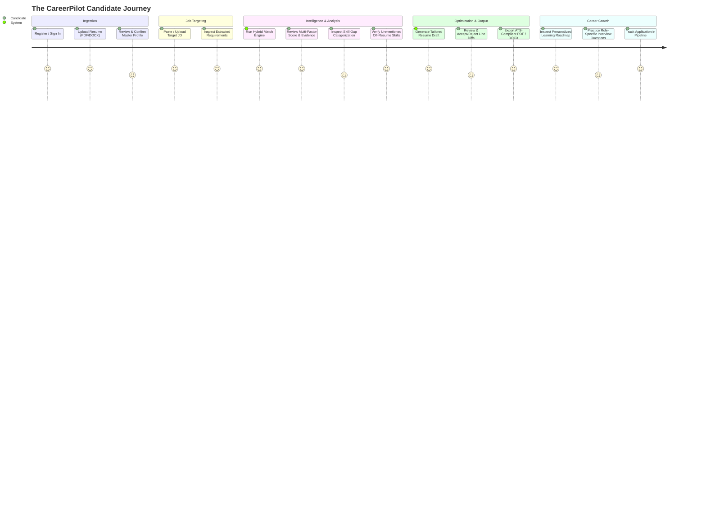

# CareerPilot — Product Requirements Document (PRD)

> **Document Version:** 1.0.0-PROPOSAL  
> **Status:** Review Ready  
> **Target Release:** CareerPilot v1.0 Enterprise MVP  
> **Classification:** Confidential / System Architecture Specification

---

## 1. Product Overview & Vision

CareerPilot is an AI-powered career intelligence platform designed for ambitious professionals and job seekers. The platform ingests candidate resumes and employer job descriptions, extracts rich structured representations, calculates multi-dimensional alignment using a hybrid semantic-lexical engine, transparently categorizes skill gaps, rewrites resume experiences without factual distortion, generates structured learning roadmaps, and synthesizes role-targeted interview preparation.

---

## 2. User Personas

### Persona A: The Mid-Level Engineer (Marcus, 28)
- **Background:** 4 years of experience as a Full-Stack Engineer working with React and Node.js.
- **Goal:** Transition into a Senior Backend Engineer role emphasizing Go, Distributed Systems, and Kubernetes.
- **Pain Point:** Doesn't know how to highlight his backend architecture accomplishments on his resume; gets rejected without feedback; unsure if his lack of commercial Kubernetes experience is an absolute blocker or a learnable gap.
- **CareerPilot Workflow:** Uses CareerPilot to match his master resume against 5 target JDs, identifies that his distributed caching work with Redis aligns with 80% of backend expectations, receives STAR-framed bullet optimizations, and follows a 4-week learning roadmap for Kubernetes.

### Persona B: The Career Switcher (Elena, 34)
- **Background:** Data Analyst with strong SQL and Tableau experience transitioning to Machine Learning Engineer.
- **Goal:** Apply for entry-to-mid Machine Learning positions.
- **Pain Point:** Resume looks like a BI analyst resume; ML projects are buried; feels overwhelmed by extensive JD requirement lists.
- **CareerPilot Workflow:** Extracts JD requirements, separates mandatory ML model evaluation skills from preferred cloud tooling, optimizes project descriptions to highlight statistical modeling, and practices targeted ML interview questions.

---

## 3. End-to-End User Journey

---

## 4. Detailed Functional Modules Specification

---

### MODULE 1: Authentication and User Workspace

#### 1.1 Purpose
Provides secure multi-user tenant authentication, account management, personal workspace isolation, and application state persistence.

#### 1.2 Functional Requirements
- **FR-1.1:** Email and password registration with cryptographic password hashing (Argon2id or bcrypt).
- **FR-1.2:** Secure token issuance (short-lived JWT access token + secure, HTTP-only refresh token).
- **FR-1.3:** Optional OAuth2 social authentication (Google, GitHub).
- **FR-1.4:** Individual user workspaces enforcing strict tenant data boundaries (every database query scoped to `user_id`).
- **FR-1.5:** User profile management (name, target job titles, target seniority levels, notification preferences).
- **FR-1.6:** Account deletion and complete personal data purge (GDPR / CCPA compliance).

#### 1.3 Technical Dependencies
- FastAPI security utilities (`fastapi.security`, `python-jose`, `passlib`).
- PostgreSQL `users` and `user_profiles` tables.
- Redis session store / token revocation blacklist.

#### 1.4 Inputs & Outputs
- **Input:** Credentials, registration payload, profile update payloads.
- **Output:** Authentication tokens, user profile metadata, active workspace contexts.

#### 1.5 API & Database Requirements
- **Endpoints:** `POST /api/v1/auth/register`, `POST /api/v1/auth/login`, `POST /api/v1/auth/refresh`, `POST /api/v1/auth/logout`, `GET /api/v1/users/me`, `PUT /api/v1/users/me`.
- **Entities:** `User`, `UserProfile`, `UserSession`.

#### 1.6 Frontend Requirements
- Split-screen Soft UI authentication screens (Login, Register, Forgot Password).
- Inset-well form inputs with clear validation error states.
- Floating label animation and accessible keyboard focus states.

#### 1.7 Acceptance Criteria & Definition of Done
- Passwords are never logged or stored in plain text.
- Cross-tenant data leakage is structurally impossible (unit tested with multi-tenant query probes).
- Tokens expire in 15 minutes (access) and 7 days (refresh).

---

### MODULE 2: Resume and Job Description Ingestion

#### 2.1 Purpose
Ingests binary and text documents (PDF, DOCX, raw text), converts them into clean standardized plain-text streams, detects layout structures, and segments documents into logical sections.

#### 2.2 Functional Requirements
- **FR-2.1:** Accept resume uploads in PDF (`application/pdf`) and DOCX (`application/vnd.openxmlformats-officedocument.wordprocessingml.document`) formats up to 10 MB.
- **FR-2.2:** Accept JD input via direct text pasting or PDF/DOCX document upload.
- **FR-2.3:** Implement dual-engine PDF extraction: high-speed digital text extraction via `pdfplumber` / `pypdf`, with automatic fallback to Tesseract OCR when text density falls below 50 characters per page.
- **FR-2.4:** DOCX extraction with XML style and bullet-point hierarchy preservation via `python-docx`.
- **FR-2.5:** Heuristic & layout-aware section boundary segmentation (Contact, Summary, Experience, Education, Skills, Projects, Certifications).
- **FR-2.6:** Interactive correction interface allowing users to review, edit, or reclassify parsed text blocks before downstream processing.

#### 2.3 Technical Dependencies
- `pdfplumber`, `pypdf`, `python-docx`, `pytesseract`, `Pillow`.
- S3 / Local MinIO document object storage.
- Background worker task queue (Celery + Redis) for large documents.

#### 2.4 Inputs & Outputs
- **Input:** Raw binary multipart file upload or raw string text.
- **Output:** Clean canonical JSON document structure (`RawDocument`, `ExtractedSections`).

#### 2.5 Acceptance Criteria
- 99% extraction accuracy on standard digital PDF resumes.
- Scanned PDF images accurately routed to OCR fallback.
- User can manually edit or reassign misclassified sections in under 3 clicks.

---

### MODULE 3: JD Intelligence Engine

#### 3.1 Purpose
Parses unstructured job postings into an actionable, semantically structured requirement ontology, categorizing requirements by necessity and domain.

#### 3.2 Functional Requirements
- **FR-3.1:** Extract core metadata: Normalized Job Title, Department, Company Name, Industry, Location, Work Mode (Remote, Hybrid, Onsite).
- **FR-3.2:** Seniority level classification (Intern, Entry, Mid, Senior, Staff/Principal, Lead, Director).
- **FR-3.3:** Extract technical skills, programming languages, frameworks, cloud services, databases, and tooling.
- **FR-3.4:** Extract domain-specific soft skills, methodologies (e.g., Agile, CI/CD), and operational processes.
- **FR-3.5:** Strict classification into **Required / Mandatory** vs. **Preferred / Bonus** qualifications.
- **FR-3.6:** Minimum years of experience extraction (overall and per specific technology).
- **FR-3.7:** Minimum education criteria (e.g., BS in Computer Science or equivalent).
- **FR-3.8:** Requirement importance weighting (1.0 = Non-negotiable mandatory, 0.7 = Strongly preferred, 0.4 = Nice-to-have).

#### 3.3 Technical Dependencies
- Pydantic v2 structured schemas.
- Instructor / Native Structured Outputs with LLM abstraction layer:
  - **Default (Zero Cost):** Local **Ollama** daemon (e.g. `llama3.1:8b`, `qwen2.5:7b`, `mistral:7b`) with native JSON schema constraints.
  - **Optional (BYOK):** Cloud LLMs (Anthropic Claude 3.5 Sonnet / OpenAI GPT-4o / Google Gemini 1.5 Pro / Groq) when configured by user.
- SpaCy rule-based linguistic patterns for entity boundary refinement.

#### 3.4 Acceptance Criteria
- Precision $\ge 92\%$ in identifying mandatory vs preferred qualifications on standard tech JDs.
- Structured output conforms 100% to Pydantic schema validation.

---

### MODULE 4: Candidate Intelligence Engine & Master Profile

#### 4.1 Purpose
Extracts and maintains an authoritative, reusable Master Candidate Profile from uploaded resumes, grounding every skill and experience item in supporting source evidence.

#### 4.2 Functional Requirements
- **FR-4.1:** Extract structured work experience: Company, Title, Start/End Dates, Location, and Individual Achievement Bullets.
- **FR-4.2:** Extract projects: Title, Description, Technologies Used, Links/URLs, Outcomes.
- **FR-4.3:** Extract education: Institution, Degree, Field of Study, Graduation Date, Honors.
- **FR-4.4:** Extract certifications, licenses, publications, and patents.
- **FR-4.5:** Extract and normalize technical competencies to canonical ontology terms (e.g., "Postgres" $\rightarrow$ "PostgreSQL").
- **FR-4.6:** Build **Evidence Anchoring Links**: Every extracted skill must store a back-pointer to the exact section, job role, or bullet text where it was demonstrated.
- **FR-4.7:** Compute skill recency and depth (e.g., "Python: 5 years, demonstrated in most recent role [2022–2026]").
- **FR-4.8:** Provide a unified UI allowing candidates to edit, enrich, and keep their Master Profile updated permanently.

#### 4.3 Acceptance Criteria
- Every competency in the master profile contains verifiable textual evidence.
- Profile persists across sessions and can be linked to unlimited job applications.

---

### MODULE 5: Candidate-Role Matching Engine

#### 5.1 Purpose
Scientific, multi-dimensional alignment analysis between the candidate's master profile and the extracted JD requirements using hybrid semantic-lexical retrieval.

#### 5.2 Functional Requirements
- **FR-5.1:** Multi-factor scoring model combining:
  1. **Lexical Match Score ($S_{lex}$):** BM25 score comparing candidate text against JD requirements.
  2. **Dense Semantic Embedding Score ($S_{sem}$):** Cosine similarity using Sentence Transformers (`BAAI/bge-small-en-v1.5` or `all-MiniLM-L6-v2`).
  3. **Skill Ontology Exact/Fuzzy Match ($S_{skill}$):** Overlap ratio weighted by requirement necessity (mandatory vs preferred).
  4. **Experience Depth Score ($S_{exp}$):** Candidate seniority and years of experience vs JD requirements.
  5. **Project & Domain Relevance Score ($S_{dom}$):** Relevance of projects and past companies to the employer's industry.
- **FR-5.2:** Weighted Composite Score calculation:
  $$S_{overall} = w_1 S_{skill} + w_2 S_{sem} + w_3 S_{lex} + w_4 S_{exp} + w_5 S_{dom}$$
  with default weights: $w_1 = 0.35, w_2 = 0.25, w_3 = 0.15, w_4 = 0.15, w_5 = 0.10$.
- **FR-5.3:** Reciprocal Rank Fusion (RRF) for ranking specific resume sections against requirement items:
  $$RRF(d) = \sum_{m \in \{lex, sem\}} \frac{1}{k + r_m(d)}$$
- **FR-5.4:** Transparent Explainability Report: Generate a breakdown detailing how each sub-score was derived, with explicit citations to candidate resume snippets.
- **FR-5.5:** Strict disclaimer: The platform states explicitly that this score represents objective qualification alignment and does not claim to duplicate any proprietary corporate ATS algorithm.

#### 5.3 Acceptance Criteria
- Overall match score is deterministic for identical inputs.
- Calculation executes in $\le 1.5$ seconds once embeddings are precomputed.
- Score breakdown is 100% explainable with zero opaque numbers.

---

### MODULE 6: Skill Gap Analysis

#### 6.1 Purpose
Categorizes job requirements into clear actionable buckets and identifies high-leverage growth areas.

#### 6.2 Functional Requirements
- **FR-6.1:** Requirement classification into four unambiguous states:
  1. **Demonstrated:** High semantic/lexical match backed by explicit resume bullet points.
  2. **Partially Demonstrated:** Related skill demonstrated (e.g., JD asks for AWS, candidate demonstrated GCP), or skill listed in skills section without project context.
  3. **Not Demonstrated:** No evidence found in the uploaded resume.
  4. **Requires User Verification:** Competencies likely possessed based on related work (e.g., candidate wrote high-performance SQL for 5 years; JD asks for Query Optimization).
- **FR-6.2:** For each gap, calculate an **Impact Score** (how severely the gap affects application competitiveness).
- **FR-6.3:** Interactive Verification Modal: Allows candidate to answer: *"Do you have experience with [Tool X] that wasn't mentioned on your resume?"*
  - If Yes $\rightarrow$ Prompts for a 1-sentence description and auto-updates Candidate Profile.
  - If No $\rightarrow$ Routes to Module 8 (Personalized Learning Engine).

#### 6.3 Acceptance Criteria
- Zero false assumptions: missing resume text is never conflated with candidate incompetence.
- Users can resolve or verify gaps with a single click.

---

### MODULE 7: AI Resume Optimizer

#### 7.1 Purpose
Generates role-specific tailored resume variants that emphasize relevant authentic experience while maintaining complete factual integrity.

#### 7.2 Functional Requirements
- **FR-7.1:** Role-Targeted Bullet Rewriting: Transform passive resume bullets into high-impact accomplishment statements following the Google XYZ formula: *Accomplished [X] as measured by [Y], by doing [Z]*.
- **FR-7.2:** **Strict Anti-Hallucination Guardrails:**
  - Cannot invent metrics, statistics, percentages, or dollar amounts.
  - Cannot add technologies, tools, or frameworks not verified in the Master Profile.
  - Cannot create fictional employers, job titles, or dates.
- **FR-7.3:** Interactive Line-by-Line Diff & Review:
  - Users view side-by-side comparisons of original vs optimized text.
  - Every proposed change has discrete "Accept", "Reject", or "Edit" buttons.
  - Changes are only committed upon explicit user acceptance.
- **FR-7.4:** Dynamic Section & Bullet Reordering: Rank most role-relevant accomplishments at the top of each experience entry.
- **FR-7.5:** Export Engines:
  - Clean, ATS-compliant PDF generation (single-column, standard fonts, no nested tables, no graphics).
  - Clean DOCX generation for manual editing.

#### 7.3 Acceptance Criteria
- 100% adherence to factual preservation guardrails (verified by automated NLI unit tests).
- Generated documents pass automated ATS parseability benchmarks (Textract/pdfplumber).

---

### MODULE 8: Personalized Learning Engine

#### 8.1 Purpose
Constructs concrete, step-by-step learning roadmaps for unresolved skill gaps identified in Module 6.

#### 8.2 Functional Requirements
- **FR-8.1:** Prioritize learning objectives by:
  - Requirement criticality in target JD (Mandatory > Preferred).
  - Skill ubiquity across related job postings.
  - Estimated learning curve / time investment.
- **FR-8.2:** Generate structured learning milestones (e.g., Week 1: Core Fundamentals, Week 2: Practical Implementation, Week 3: Portfolio Project).
- **FR-8.3:** Recommend specific practical projects that produce verifiable portfolio artifacts (e.g., "Build a multi-stage Docker container pipeline with GitHub Actions").
- **FR-8.4:** Suggest curated, high-quality documentation links, official tutorials, and reputable learning references.
- **FR-8.5:** Clearly separate existing verified capabilities from recommended future competencies.

#### 8.3 Acceptance Criteria
- Every recommended milestone includes a concrete, testable deliverable.
- Roadmap updates dynamically when the user marks skills as acquired.

---

### MODULE 9: Interview Intelligence

#### 9.1 Purpose
Prepares candidates for high-stakes technical and behavioral interviews tailored specifically to the target role and their individual profile gaps.

#### 9.2 Functional Requirements
- **FR-9.1:** Generate role-specific technical deep-dive questions based on the candidate's declared stack and the JD's requirements.
- **FR-9.2:** Generate behavioral questions mapped to target company values and leadership principles using the STAR method (Situation, Task, Action, Result).
- **FR-9.3:** Generate **Gap-Targeted Questions:** Simulates difficult interview scenarios where interviewers probe areas of weak resume alignment (e.g., *"We see you have extensive AWS experience, but this role is GCP-native. How would you handle the transition?"*).
- **FR-9.4:** Provide structured answer frameworks, key architectural talking points, and pitfalls to avoid.
- **FR-9.5:** Interactive Mock Mode: Candidate types or records a bulleted answer; system evaluates completeness, relevance, and clarity against a rubric.

#### 9.3 Acceptance Criteria
- Generates at least 10 high-quality, non-generic interview prompts per analyzed role.
- Answer evaluation provides actionable structural critiques rather than simple praise.

---

### MODULE 10: Job Application Management & Pipeline

#### 10.1 Purpose
Centralized hub for managing multi-opportunity job searches, tracking application stages, and linking tailored resumes to specific company postings.

#### 10.2 Functional Requirements
- **FR-10.1:** Application Kanban Board with standardized stages:
  - `Bookmarked / Target`
  - `Tailoring & Review`
  - `Applied`
  - `Screening / Interviewing`
  - `Offer Received`
  - `Archived / Rejected`
- **FR-10.2:** Application Detail View: Stores target JD, match score history, tailored resume version, interview preparation notes, recruiter contact details, and follow-up deadlines.
- **FR-10.3:** Comparative Application Matrix: Allows candidates to compare requirements, match scores, and compensation across multiple target roles.
- **FR-10.4:** Application timeline and activity logging (date applied, interview rounds, offers).

#### 10.3 Acceptance Criteria
- Drag-and-drop Kanban updates application state instantly.
- Each application links to its exact tailored resume version and match evaluation record.

---

## 5. Non-Functional Requirements (NFRs)

| Category | Requirement Specification |
| :--- | :--- |
| **Operational Cost**| **$0.00 / 100% Free Default.** Runs entirely on local Ollama, local Sentence Transformers, PostgreSQL, Redis, and Tesseract with zero paid API requirements. |
| **Performance** | API response $\le 200\text{ ms}$ for standard queries. Document parsing and embedding calculation $\le 5.0\text{ s}$ via background queue. Local Ollama inference $\le 4.0\text{ s}$ on consumer GPU/Apple Silicon. |
| **Scalability** | Horizontally scalable stateless API workers. PostgreSQL connection pooling via PgBouncer. Redis for task queuing and caching. |
| **Security** | TLS 1.3 in transit, AES-256 at rest. Strict user data tenancy. OWASP Top 10 compliance. Prompt injection mitigation on all parsed document inputs. |
| **Privacy & GDPR** | Complete data sovereignty: resumes never leave host when using local Ollama. Explicit user consent if activating optional cloud APIs. Complete one-click account and data purge. |
| **Accessibility** | 100% WCAG 2.1 Level AA compliance. Semantic HTML, accessible ARIA attributes, full keyboard navigation, $\ge 4.5:1$ text contrast. |
| **Reliability** | 99.9% uptime target. Graceful degradation: if Ollama is unreachable, heuristic matching and offline models still function. |
