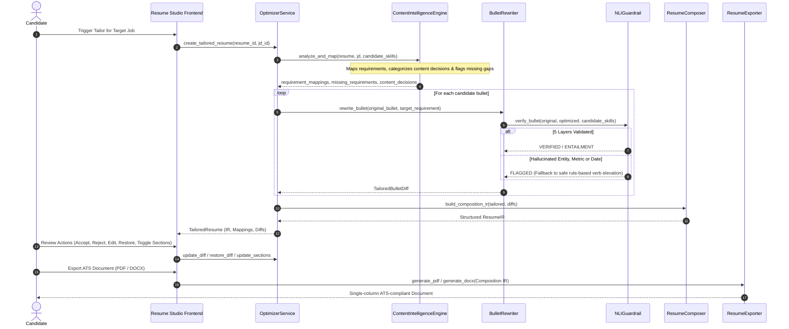

# Resume Studio 2.0: Content Intelligence, Factual Guardrails & ATS Document Generation

## 1. Architectural Philosophy: "Optimize Presentation, Not Reality"

Resume Studio 2.0 is the flagship career intelligence subsystem of CareerPilot. It transforms raw candidate experience into tailored, ATS-optimized, role-specific presentations while strictly adhering to factual reality:

1. **Optimize Presentation, Not Reality:** The engine elevates technical clarity and role alignment, but **never** invents qualifications, fabricated metrics, ungrounded technologies, shifted dates, or unearned leadership titles.
2. **Transparent Evidence Provenance:** Every proposed bullet rewrite and tailored section maps directly back to the candidate's original resume or verified candidate profile.
3. **Multi-Layer Factual Guardrails:** Layered entity, metric, temporal, and semantic invariant validation guarantees 0% hallucination.
4. **Candidate Sovereignty:** The candidate retains full authority over every change with 1-click Accept, Reject, Custom Edit, and **Restore Original** controls.
5. **Deterministic ATS Strictness:** Exporters produce parse-safe single-column layouts with standard font hierarchies, orphan header prevention, and Unicode normalization.

---

## 2. End-to-End Resume Studio Workflow

---

## 3. Subsystem Specifications

### M11.1 — Content Intelligence & Selection Engine
The `ContentIntelligenceEngine` decomposes the candidate's resume across all structural sections:
- Professional Summary
- Work Experience
- Technical Skills
- Projects
- Education & Certifications
- Awards & Achievements

**Decision Categorization:**
- `INCLUDED`: Core foundational evidence or structural section.
- `PROPOSED_REWRITE`: Relevant item selected for role-specific active phrasing enhancement.
- `REORDERED`: Skills reordered to prioritize required competencies at the top without discarding others.
- `EXCLUDED`: Low contextual density or manually toggled off by candidate.
- `MISSING_INFO`: Job requirement with no substantiating evidence in resume or profile.

### M11.2 — Structured Requirement-to-Evidence Mapping
Each target JD requirement is mapped to candidate resume items and labeled honestly:
- `matching_method`:
  - `ONTOLOGY_EXACT`: Exact canonical skill match in candidate evidence.
  - `DENSE_OLLAMA`: High-dimensional dense semantic similarity via local Ollama embeddings.
  - `LEXICAL_BM25_FALLBACK`: Probabilistic token matching when Ollama is unavailable.
  - `DENSE_HASH_FALLBACK`: Deterministic n-gram hashed vector cosine similarity fallback.
- `verification_status`:
  - `CANDIDATE_VERIFIED`: Mapped to a skill explicitly verified by the user in Candidate Profile.
  - `EXTRACTED_UNCONFIRMED`: Inferred from extracted resume text but unconfirmed by user.
  - `UNMATCHED`: Identified as a missing requirement gap with actionable advice (no hallucination).

### M11.3 — Context-Aware Resume Rewriting Engine
The `BulletRewriter` upgrades passive descriptions into active technical contributions:
- Context-Aware Elevation:
  - If source bullet has metrics (e.g., "reduced latency by 35%"), preserves metrics exactly and emphasizes context.
  - If source bullet does NOT have metrics, avoids forcing the Google XYZ formula or fabricating metrics; elevates active verbs and technical systems instead.
  - Banned Jargon: Filters out generic AI filler ("synergy", "spearheaded paradigms", "cutting-edge").
  - Verb Mapping: Replaces weak verbs (`worked on`, `helped with`, `responsible for`, `handled`, `fixed`) with precise technical impact verbs (`Architected`, `Engineered`, `Orchestrated`, `Diagnosed and resolved`).

### M11.4 — 5-Layer Factual Preservation Guardrail
The `NLIGuardrail` protects candidate integrity with zero tolerance for fabrication:
1. **Layer 1: Entity Validation:** Extracted technologies, frameworks, libraries, tools, and platforms must belong to the allowed set: $\text{Entities}(\text{Original}) \cup \text{Entities}(\text{Candidate Verified})$.
2. **Layer 2: Quantitative Validation:** Percentages, currencies, multipliers ($2x, 5x$), latencies ($10ms$), and counts must exist in the source bullet.
3. **Layer 3: Temporal Validation:** Calendar years ($1900-2099$), month names, and durations cannot be injected or shifted.
4. **Layer 4: Semantic Scope & Seniority Preservation:** Prevents unearned seniority inflation (e.g. elevating developer claims to "Chief Architect", "CTO", or "Sole inventor").
5. **Layer 5: Standardized Review Statuses:**
   - `VERIFIED`: Passed all deterministic invariant layers.
   - `FLAGGED`: Violates entity, metric, temporal, or seniority rules. Never silently accepted.
   - `REQUIRES_REVIEW`: Semantic shift detected requiring human candidate sign-off.
   - `NOT_VERIFIED`: Insufficient evidence.

### M11.5 — Resume Composition Engine & Intermediate Representation (IR)
The `ResumeComposer` produces a structured `ResumeIR`:
- `candidate_identity`: Factual candidate name, verified email, headline, contact string, and professional links.
- `sections`: List of sections with `is_included`, `display_order`, items, and composed bullets.
- `export_sections`: Filtered, sorted snapshot formatted for deterministic rendering.
- `provenance`: Complete audit trail linking every composed bullet back to source bullet, diff, and target requirement.
- **Candidate Controls:**
  - `Accept`: Applies optimized bullet.
  - `Reject`: Retains original bullet.
  - `Custom Edit`: Overrides with candidate's exact wording.
  - `Restore Original`: Reverts any diff back to original text in 1 click.
  - `Toggle Section`: Include or exclude entire sections from the final document.

### M11.6 — Interactive Resume Studio Frontend
Located at `/optimizer`:
- Target Role Context Banner (title, company, requirements mapped vs missing).
- Telemetry bar (Total diffs, Applied, Pending, Verified, Requirements count).
- Subsystem tabs: Diff Review Hub, Requirement-to-Evidence Matrix, Section Controls.
- Live ATS Document Preview Canvas (real-time single-column simulation).
- Export PDF & DOCX buttons with progress states.

### M11.7 — Reliable ATS Exporters
The `ResumeExporter` implements single-column document generation:
- **PDF (ReportLab):** Letter size, 40pt margins, Helvetica typography, `keepWithNext=True` on headings to prevent orphan headers, XML entity and Unicode character sanitization.
- **DOCX (python-docx):** 0.75-inch standard margins, Arial typography, `keep_with_next=True`, native `List Bullet` styles.
- **Pre-Export Validation:** Validates that candidate identity and at least one section exist before generating export files.

---

## 4. Verification & Testing Matrix

| Component | Automated Test | Verification Target |
| :--- | :--- | :--- |
| Layered Guardrail | `test_nli_guardrail_factual_preservation` | Rejects new tech, fabricated metrics, dates, and seniority inflation |
| Content Intelligence | `test_content_intelligence_and_requirement_mapping` | Accurate requirement-to-evidence mapping & missing gap detection |
| Composition IR | `test_resume_composition_ir_and_provenance` | Structured IR, source traceability, and provenance auditing |
| Rewriter | `test_bullet_rewriter_google_xyz_formula` | Active verb elevation, fact preservation, and rationale generation |
| Pre-Export Validation | `test_exporter_pre_validation` | Rejects empty content and missing candidate identity |
| Document Export | `test_resume_export_pdf_and_docx` | Valid PDF (`%PDF`) and DOCX (`PK\x03\x04`) binary generation |
| Full API Lifecycle | `test_tailor_resume_api_lifecycle_and_tenancy` | Complete tailoring, review, restore, section toggle, export & tenancy |
