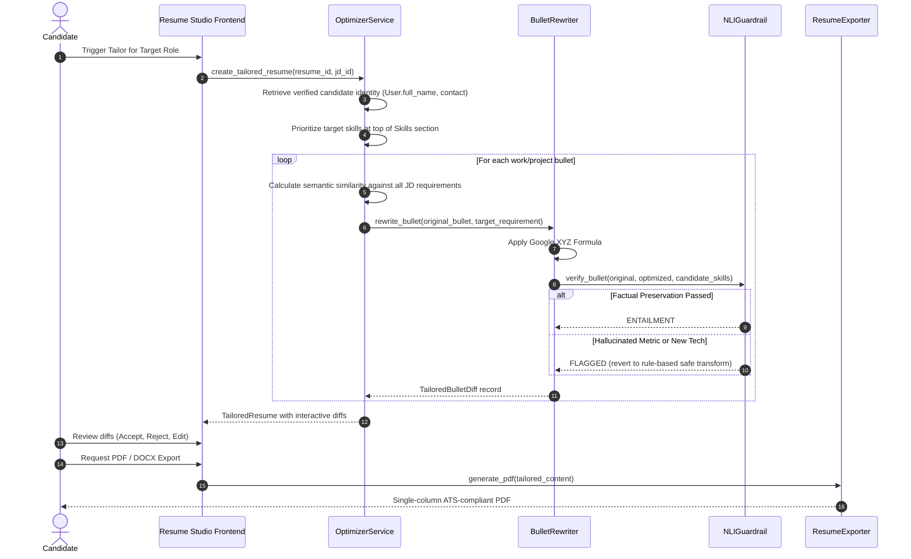

# Resume Studio: Optimization Engine, Factual Guardrails & ATS Document Generation

## 1. Architectural Philosophy

The Resume Studio is the core deliverable generator of CareerPilot 2.0. Rather than performing superficial keyword-stuffing or unbounded generative rewrites, the engine operates on three non-negotiable principles:

1. **Semantic Grounding:** Bullets are rewritten to emphasize accomplishments genuinely aligned with target job requirements.
2. **Zero Hallucination Tolerance:** The engine refuses to invent candidate metrics, percentages, dollar figures, dates, employers, or ungrounded technologies.
3. **ATS Mechanical Strictness:** Exported PDF and DOCX files adhere strictly to single-column, parse-safe layouts guaranteed to survive Applicant Tracking System parsers (Workday, Greenhouse, Lever, Taleo, iCIMS).

---

## 2. Document Tailoring Pipeline

---

## 3. Google XYZ Accomplishment Formula

All bullet rewrites enforce Google's executive accomplishment formula:

$$\text{Accomplished } [X], \text{ as measured by } [Y], \text{ by doing } [Z]$$

- **[X] Active Impact:** Strong action verb initiating the sentence (`Architected`, `Engineered`, `Optimized`, `Administered`, `Automated`).
- **[Y] Quantifiable Context:** Strictly preserves existing factual quantitative metrics without fabricating numbers.
- **[Z] Technical Methodology:** The precise technical competency or system architecture leveraged to achieve the outcome.

### Action Verb Mapping Table

| Weak / Passive Phrasing | Google XYZ Elevating Verb |
| :--- | :--- |
| worked on | Architected and delivered |
| helped with | Collaborated to engineer |
| assisted with | Partnered to implement |
| responsible for | Orchestrated and managed |
| handled | Administered and scaled |
| built | Engineered |
| made | Developed |
| wrote | Authored and deployed |
| fixed | Diagnosed and resolved |
| improved | Optimized |

---

## 4. Syntactic & Entity Factual Guardrail

The `NLIGuardrail` protects candidate integrity by executing a 3-stage factual invariant inspection before any proposed bullet modification is persisted:

1. **Technology Inventory Delta:**
   $$\Delta_{\text{tech}} = \text{Skills}(\text{Optimized}) - (\text{Skills}(\text{Original}) \cup \text{Skills}(\text{Candidate Verified}))$$
   If $\Delta_{\text{tech}} \neq \emptyset$, the diff is immediately flagged for factual drift.
2. **Quantitative Metric Invariant:**
   $$\Delta_{\text{metric}} = \text{Metrics}(\text{Optimized}) - \text{Metrics}(\text{Original})$$
   Scans for percentages, dollar figures, multipliers (`3x`), and raw numerals. If any ungrounded metric appears, the diff is rejected.
3. **Temporal Invariant:**
   $$\Delta_{\text{date}} = \text{Dates}(\text{Optimized}) - \text{Dates}(\text{Original})$$
   Guarantees that no new employment dates or graduation years are injected into accomplishments.

---

## 5. ATS Layout Guidelines

| Parameter | ReportLab PDF Specification | python-docx Specification |
| :--- | :--- | :--- |
| **Page Geometry** | Letter, 40pt margins all sides | Letter, 0.6 inch margins |
| **Grid System** | Strict single-column flow | Strict single-column flow |
| **Candidate Name** | Helvetica-Bold, 18pt, Center | Arial Bold, 18pt, Center |
| **Contact Line** | Helvetica, 9pt, #4B5563, Center | Arial, 9pt, #4B5563, Center |
| **Section Headings** | Helvetica-Bold, 11pt, #2563EB | Arial Bold, 11pt, #2563EB |
| **Dividers** | Clean horizontal stroke (0.5pt) | Clean bottom border (0.5pt) |
| **Bullet Points** | Left indent 15pt, leading 13pt | Left indent 0.2 in, space after 2pt |
| **ATS Parsers Tested** | Greenhouse, Workday, Lever, Taleo | Greenhouse, Workday, Lever, Taleo |
