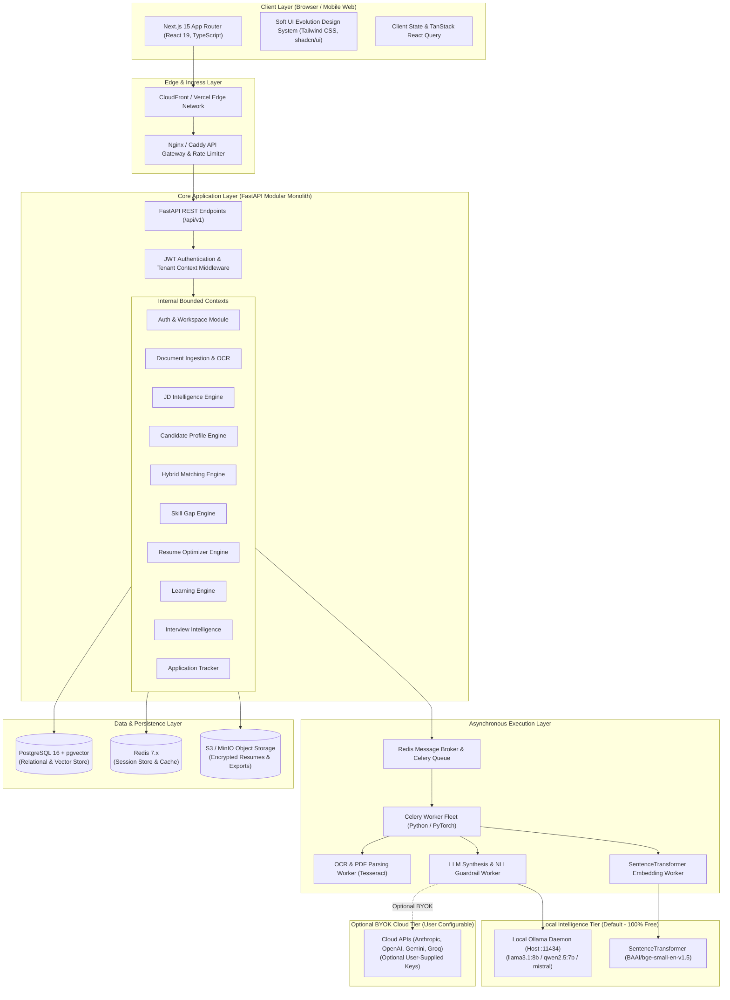
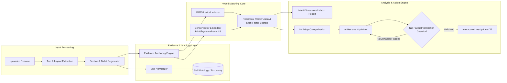
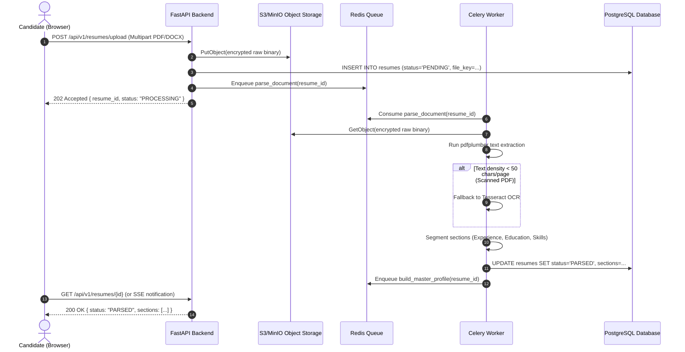
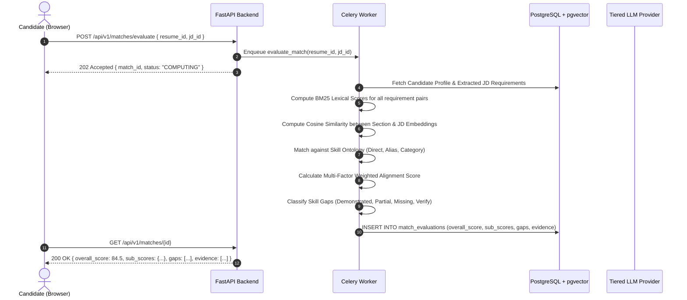
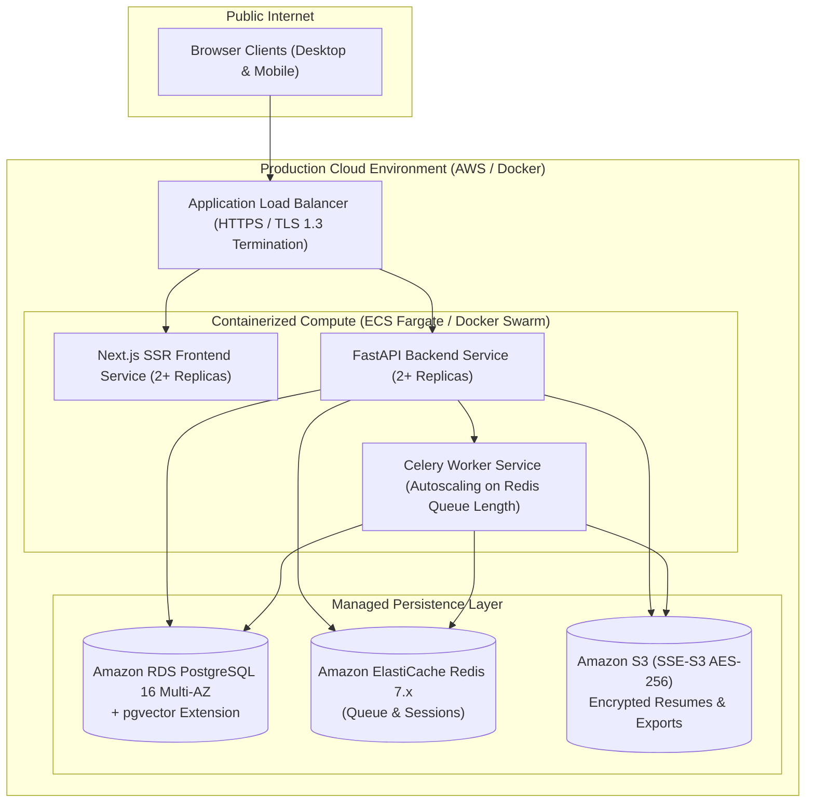

# CareerPilot — System Architecture Specification

> **Document Version:** 1.0.0-PROPOSAL  
> **Status:** Review Ready  
> **Author:** Principal Software Architect & Senior AI Engineer  
> **Target Environment:** Multi-User SaaS (Local Dev $\rightarrow$ Production Cloud)

---

## 1. Architectural Philosophy: The Modular Monolith

CareerPilot is architected as a **disciplined Modular Monolith** with an independent asynchronous worker fleet. 

### Why Modular Monolith?
1. **Premature Microservices Avoidance:** Microservices introduce distributed transaction overhead, complex network serialization, data consistency challenges, and operational toil without providing immediate scaling benefits for early-stage or growing SaaS systems.
2. **Domain Boundary Rigor:** Code is organized into strictly isolated internal modules (bounded contexts) communicating via typed service interfaces. If a specific component (e.g., Document Ingestion & OCR) requires independent horizontal scaling, it can be decomposed into an independent micro-service with zero domain refactoring.
3. **Single Source of Truth:** A unified PostgreSQL instance utilizing row-level security and `user_id` scoping prevents distributed database desynchronization while maintaining complete tenant isolation.
4. **Asynchronous Decoupling:** Long-running operations (OCR, PDF generation, LLM batch evaluation, embedding calculations) are offloaded to an asynchronous Redis + Celery worker queue, keeping HTTP request-response cycles sub-200ms.

---

## 2. High-Level System Architecture



---

## 3. Component Architecture Breakdown

### 3.1 Frontend Architecture (Next.js 15 + React 19)
- **Framework:** Next.js App Router (`/app` directory) with React Server Components (RSC) for initial page renders and Client Components for rich interactive surfaces.
- **Styling & Aesthetics:** Tailwind CSS v4 configured with the custom **Soft UI Evolution** design tokens, dual box shadows, and inset wells.
- **Component Primitives:** Radix UI / shadcn/ui primitives heavily customized to adhere to soft tactile neumorphic principles and WCAG AA contrast standards.
- **State Management & Data Fetching:**
  - TanStack React Query v5 for server state caching, optimistic updates, and automatic background invalidation.
  - Zustand for ephemeral client state (e.g., active resume diff review, live editor view modes).
- **Form Handling:** React Hook Form with Zod schema validation matching backend Pydantic models.

### 3.2 Backend Architecture (FastAPI Modular Monolith)
- **Framework:** FastAPI with Python 3.11+ using asynchronous ASGI endpoints (`async def`).
- **Validation & Serialization:** Pydantic v2 for strict runtime request/response validation.
- **ORM & Data Access:** SQLAlchemy 2.0 with async engine (`asyncpg`) and Alembic for schema migrations.
- **Tenant Isolation:** Enforced via dependency injection (`get_current_active_user`) which injects `user_id` into every database repository query. Unscoped queries are forbidden by static architectural linters.
- **Modular Directory Hierarchy:**
  ```
  backend/
  ├── app/
  │   ├── core/              # Config, Security, DB session, Celery app, Base classes
  │   ├── modules/
  │   │   ├── auth/          # User authentication, registration, tokens
  │   │   ├── ingestion/     # PDF/DOCX extractors, OCR fallback, section segmenters
  │   │   ├── jd_engine/     # JD extraction, requirement classification
  │   │   ├── candidate/     # Master Profile, skill extraction, evidence anchoring
  │   │   ├── matching/      # BM25, embeddings, cosine similarity, RRF, scoring
  │   │   ├── skill_gap/     # Gap categorization, verification triggers
  │   │   ├── optimizer/     # Bullet rewriting, NLI guardrails, PDF/DOCX generation
  │   │   ├── learning/      # Roadmap generation, milestones
  │   │   ├── interview/     # STAR questions, mock rubric generation
  │   │   └── applications/  # Kanban tracker, stage management, history
  │   └── main.py            # FastAPI application entrypoint
  ```

### 3.3 Asynchronous Processing Engine (Celery + Redis)
To guarantee that the web API remains snappy and never blocks on compute-heavy operations, long-running tasks are dispatched to Celery:
1. `tasks.parse_document`: Ingests binary files from S3/MinIO, executes `pdfplumber` or OCR, and writes parsed text back to PostgreSQL.
2. `tasks.compute_embeddings`: Computes 384-dimensional dense vectors for candidate resume sections and JD requirements via `SentenceTransformer`.
3. `tasks.evaluate_match`: Runs the hybrid lexical-semantic matching pipeline and populates the match report.
4. `tasks.generate_tailored_resume`: Calls the LLM to rewrite bullet points, runs NLI factual verification, and prepares diff suggestions.
5. `tasks.export_resume_file`: Renders clean, ATS-compliant PDF and DOCX files.

---

## 4. AI & Data Processing Architecture



---

## 5. End-to-End Data Flow Sequences

### Sequence 1: Document Upload & Ingestion Data Flow


### Sequence 2: Hybrid Candidate-Role Match Evaluation Data Flow


---

## 6. Deployment Architecture



### Local Development Environment (Docker Compose)
For friction-free local engineering with zero operational cost, the entire system is runnable via a single `docker compose up -d` specification:
- `frontend`: Next.js development server with hot-reload (`:3000`).
- `backend`: FastAPI with Uvicorn hot-reload (`:8000`).
- `celery-worker`: Celery worker attached to local code volume, connecting to local Ollama via `host.docker.internal:11434`.
- `postgres`: PostgreSQL 16 image with `pgvector` pre-installed (`:5432`).
- `redis`: Redis 7 Alpine (`:6379`).
- `minio`: S3-compatible local object store with console (`:9000`, `:9001`).
- `ollama`: Uses the host's existing local Ollama installation (e.g. running `ollama serve` on port 11434).

---

## 7. Architectural Decisions & Trade-Offs

| Decision | Chosen Solution | Alternative Evaluated | Trade-Off Justification |
| :--- | :--- | :--- | :--- |
| **LLM Inference Engine** | **Local Ollama (Default) + BYOK Cloud (Optional)** | Cloud-only Paid APIs (OpenAI/Anthropic) | Guarantees **100% free operation** with zero recurring API costs. Protects user privacy (resumes never leave machine). Advanced users can still opt into external API keys. |
| **Monolith vs Microservices** | Modular Monolith | Microservices | Eliminates distributed network latency, deployment overhead, and cross-service orchestration complexity; clean internal module interfaces allow decomposition later if required. |
| **Vector Storage** | PostgreSQL with `pgvector` | Pinecone / Qdrant / Weaviate | Keeps relational data (users, resumes, jobs) and vector embeddings in a single ACID database. Zero dual-write sync issues; eliminates additional SaaS subscription costs. |
| **Embeddings Model** | `BAAI/bge-small-en-v1.5` | OpenAI `text-embedding-3-small` | High MTEB retrieval performance, local execution (zero API per-token cost), fast inference ($\sim 15\text{ ms}$ on CPU/GPU), complete user data privacy. |
| **OCR Fallback** | Tesseract via PyTesseract | AWS Textract / Cloud Vision | Tesseract handles standard scanned resumes at zero variable cost; Textract is reserved as an optional enterprise plug-in if customer demands heavy multi-column graphics OCR. |
| **Frontend Framework** | Next.js 15 (App Router) | Vite + React SPA | Enables SSR for public marketing pages and rich SEO, while providing seamless React Server Components and API route streaming for authenticated dashboards. |
| **Design Language** | Soft UI Evolution | Standard Flat / Material / Brutalism | Delivers a distinguished, high-end SaaS feel through tactile depth and inset wells while adhering rigorously to WCAG AA contrast standards. |
